# OAuth 2.0 Form Post Response Mode 1.0 (Modern Spec Edition)

> **Unvalidated working example — unofficial adaptation.** This document is an exercise in specification development. It is not an OpenID Foundation publication or an authoritative replacement for the source specification. Semantic equivalence, conformance, and interoperability have not been established.

## Source and rights notice

This example adapts [OAuth 2.0 Form Post Response Mode, Final, April 27, 2015](https://openid.net/specs/oauth-v2-form-post-response-mode-1_0.html), by Michael B. Jones and Brian Campbell. The OpenID Foundation is the source of the adapted material. This attribution does not imply endorsement by the OpenID Foundation.

Copyright (c) 2015 The OpenID Foundation.

The source's [Appendix C — Notices](https://openid.net/specs/oauth-v2-form-post-response-mode-1_0.html#AppendixC) supplies the applicable copyright permission and other notices. Its copyright grant permits reproduction, preparation of derivative works, distribution, performance, and display solely for developing specifications and implementing Implementers Drafts and Final Specifications based on those documents, subject to attribution without implying endorsement. Consult Appendix C for the full terms, disclaimers, and intellectual property notices.

The repository's CC0 dedication applies only to original contributions to the extent their contributors hold the relevant rights. It does not relicense the underlying specification or other third-party material. Do not treat this entire example as CC0 material.

## Review status and known differences

An [iteration 1 source comparison](oauth_2_0_form_post_response_mode_1_0_review.md) records findings and their effect on the guideline. This example's protocol body remains the reviewed baseline; the report does not establish conformance or resolve the listed differences.

This adaptation reorganizes the source into actors, a sequence diagram, constraint tables, labeled provisions, and wire examples. The following items need review to determine whether the guideline produces clear implementation behavior and test requirements:

- `REQ3.1` makes HTTP `200 OK` mandatory, although the source shows that status in its non-normative Appendix A example rather than requiring it in Section 2.
- `REQ3.5` and `REQ3.7` make specific input elements and cache headers mandatory. Clarify whether these mechanisms are deliberate conformance requirements or illustrative implementation choices.
- `META1`, `REQ2`, and the variable constraints need review to distinguish presentation delimiters, HTML syntax and escaping, and quotation marks within actual values.

These are initial review findings, not an exhaustive list. The protocol provisions below remain unchanged for further evaluation. Compare them with the authoritative source; do not rely on them as a validated implementation specification.

## 1. Scope
This document specifies the `form_post` Response Mode for OAuth 2.0. It defines how an Authorization Server encodes OAuth 2.0 Authorization Response parameters as HTML form values and transmits them to a Client via a User Agent using the HTTP `POST` method.

## 2. Normative References
All external specifications required to interpret this document are listed below:
* **[RFC2119]** Bradner, S., "Key words for use in RFCs to Indicate Requirement Levels", BCP 14, RFC 2119, March 1997.
* **[RFC6749]** Hardt, D., "The OAuth 2.0 Authorization Framework", RFC 6749, October 2012.
* **[RFC7230]** Fielding, R. and J. Reschke, "Hypertext Transfer Protocol (HTTP/1.1): Message Syntax and Routing", RFC 7230, June 2014.
* **[HTML401]** Raggett, D., Le Hors, A., and I. Jacobs, "HTML 4.01 Specification", W3C Recommendation, December 1999.
* **[OAuth.Responses]** de Medeiros, B., Ed., Scurtescu, M., Tarjan, P., and M. Jones, "OAuth 2.0 Multiple Response Type Encoding Practices", February 2014.

## 3. Terms and Definitions
This document imports the following terms from external specifications without modification:
* From **[RFC6749]**: *Access Token*, *Authorization Code*, *Authorization Endpoint*, *Authorization Grant*, *Authorization Response*, *Authorization Server*, *Client*, *Client Identifier*, *Client Secret*, *Protected Resource*, *Redirection URI*, *Refresh Token*, *Resource Owner*, *Resource Server*, *Response Type*, *Token Endpoint*.
* From **[RFC7230]**: *User Agent*, *Intermediary*.
* From **[OAuth.Responses]**: *Response Mode*.

This document defines the following term:
* **Form Post Response Mode**: A Response Mode where the Authorization Server encodes Authorization Response parameters as HTML form values for the User Agent to submit to the Client via an HTTP `POST` request using the `application/x-www-form-urlencoded` format.

## 4. Abbreviations and Symbols

| Abbreviation | Full Term |
| :--- | :--- |
| **AS** | Authorization Server |
| **HTML** | HyperText Markup Language |
| **HTTP** | Hypertext Transfer Protocol |
| **UA** | User Agent |
| **URI** | Uniform Resource Identifier |

## 5. Actors

### Target Implementation Actors
* **Client**: An application that makes protected resource requests on behalf of the Resource Owner and with the Resource Owner's authorization.
* **Authorization Server (AS)**: A server that issues Access Tokens and Authorization Responses to the Client after the server authenticates the Resource Owner and obtains authorization.

### External / Uncontrolled Actors
* **User Agent (UA)**: A web browser or similar software that acts on behalf of the Resource Owner and mediates HTTP communication between the Client and the AS.
* **Intermediary**: A network component (such as a proxy or cache) positioned between the UA and the AS, or between the UA and the Client.

## 6. Goal
The goal of this specification is to enable the AS to return Authorization Response parameters (including parameters that default to URL query string or URL fragment encoding) to the Client inside an HTTP `POST` message body. This prevents the exposure of sensitive parameters in URL query strings, browser history, or server access logs.

## 7. Interactions
Each step in the sequence diagram below is cross-referenced with Section 8 (Variables) and Section 9 (Provisions).

```mermaid
sequenceDiagram
    autonumber
    actor UA as User Agent (UA)
    participant Client as Client
    participant AS as Authorization Server (AS)

    Client->>UA: 1. [REQ1, REQ2] Redirect to AS Authorization Endpoint (response_mode=form_post)
    UA->>AS: 2. [REQ1, REQ2] Send HTTP GET/POST Authorization Request (response_mode=form_post)
    Note over UA,AS: 3. Resource Owner authenticates and grants authorization (Out of Scope)
    AS->>UA: 4. [REQ2, REQ3, PERM1] Return HTTP 200 OK with HTML <form method="POST" action="Redirection URI"> (Cache-Control: no-cache, no-store)
    Note over UA: 5. [REQ3.6, PERM1.1] Standard UA behavior: Execute onload script and submit HTML form
    UA->>Client: 6. [REQ4.1, REQ4.2] Send HTTP POST to Redirection URI (Content-Type: application/x-www-form-urlencoded)
    Client->>UA: 7. [REQ4.3] Process Authorization Response parameters and return HTTP response
```



## 8. Variable Values and Constraints

### Meta-Rules for Protocol Values
* **META1**: Quotation marks (`"`) in this specification are delimiters for text presentation only. Actors **MUST NOT** include quotation marks inside actual parameter values or HTML attribute values unless explicitly specified (see `REQ2`).
* **META2**: Parameter names and string values are case-sensitive unless explicitly stated otherwise in the constraints table below.

### Variable Constraints Table

| Variable / Attribute | Context | Sequence Step & Provisions | Type | Allowed Values | Disallowed Values |
| :--- | :--- | :--- | :--- | :--- | :--- |
| `response_mode` | Authorization Request parameter | Steps 1, 2 (`REQ1.1`, `REQ1.2`, `REQ2`) | String | Exact string `form_post` (when requesting this mode) | Quoted strings (e.g., `"form_post"`), case variations (e.g., `FORM_POST`), empty string. |
| `Content-Type` (AS Response) | HTTP Response Header from AS | Step 4 (`REQ3.1`) | Media Type | `text/html` (with recommended `charset=UTF-8`, e.g., `text/html;charset=UTF-8`) | `application/json`, `text/plain`, or omitted header. |
| `Cache-Control` | HTTP Response Header from AS | Step 4 (`REQ3.7`) | String | Directives containing `no-cache, no-store` | `public`, `max-age` greater than `0`, or omitted header. |
| `Pragma` | HTTP Response Header from AS | Step 4 (`REQ3.7`) | String | `no-cache` | Omitted header. |
| `<form method>` | HTML Response from AS | Step 4 (`REQ3.4`, `REQ3.6`) | String | `POST` or `post` (case-insensitive per **[HTML401]**) | `GET`, `PUT`, `DELETE`, `DIALOG`, or omitted attribute. |
| `<form action>` | HTML Response from AS | Step 4 (`REQ3.3`, `REQ3.6`) | URI | The exact `Redirection URI` registered by and validated for the Client. | Unvalidated URIs, relative paths, or URIs that do not match the Client's `Redirection URI`. |
| `<input type>` | HTML `<form>` child elements for response parameters | Step 4 (`REQ3.5`) | String | `hidden` (case-insensitive per **[HTML401]**) | `text`, `password`, or omitted `type` attribute for response parameters. |
| `<input name>` | HTML `<form>` child elements | Step 4 (`REQ2`, `REQ3.5`) | String | Valid OAuth 2.0 Authorization Response parameter names (e.g., `code`, `state`, `id_token`, `error`). | Empty string, unescaped HTML characters, or literal surrounding quotes. |
| `<input value>` | HTML `<form>` child elements | Step 4 (`REQ2`, `REQ3.5`) | String | HTML-escaped value of the corresponding Authorization Response parameter. | Unescaped HTML characters (e.g., raw `<`, `>`, `&`, `"`), or literal surrounding quotes. |
| `Content-Type` (UA Request) | HTTP `POST` Request received by Client from UA | Step 6 (`REQ3.6`, `REQ4.1`, `REQ4.2`) | Media Type | `application/x-www-form-urlencoded` (with optional `charset` parameter) | `multipart/form-data`, `text/plain`, `application/json`. |

## 9. Requirements, Recommendations, and Permissions

### Requesting Form Post Response Mode (Steps 1–2)
* **REQ1 (Steps 1, 2)**: To request the Form Post Response Mode in Step 1 (transmitted to the AS in Step 2), the Client **MUST**:
  1. Include the `response_mode` parameter in the Authorization Request;
  2. Set the `response_mode` parameter value to `form_post` (per Section 8, `response_mode`).
* **REQ2 (Steps 1, 2, 4)**: When the Client or the AS serializes literal parameter values in protocol messages (Steps 1, 2, and 4), the Client and the AS **MUST NOT** include quotation marks around the parameter values (per `META1`).

### Generating the Authorization Response (Steps 4–5)
* **REQ3 (Steps 4, 5)**: When the AS returns an Authorization Response (including an Authorization Error Response) using the `form_post` Response Mode in Step 4, the AS **MUST**:
  1. Return an HTTP `200 OK` response with the `Content-Type` header set to `text/html` (per Section 8, `Content-Type (AS Response)`);
  2. Include an HTML `<form>` element in the HTTP response body;
  3. Set the `action` attribute of the HTML `<form>` element to the Client's validated `Redirection URI` (per Section 8, `<form action>`);
  4. Set the `method` attribute of the HTML `<form>` element to `POST` (per Section 8, `<form method>`);
  5. Encode each Authorization Response parameter as an HTML `<input type="hidden">` element inside the `<form>` element, setting the `name` attribute to the parameter name and the `value` attribute to the HTML-escaped parameter value (per Section 8, `<input type>`, `<input name>`, `<input value>`);
  6. Structure the HTML `<form>` element so that a standard UA (in Step 5) encodes the form parameters in the `application/x-www-form-urlencoded` format and transmits them in the HTTP `POST` request body (in Step 6) to the Client's `Redirection URI`;
  7. Include the `Cache-Control: no-cache, no-store` HTTP response header and the `Pragma: no-cache` HTTP response header (per Section 8, `Cache-Control`, `Pragma`) so that the UA and any Intermediary do not store or reuse the HTTP response content.
* **PERM1 (Steps 4, 5)**: When the AS generates the HTML response in Step 4 to trigger form submission in Step 5, the AS **MAY**:
  1. Use any technique supported by the UA (such as JavaScript `onload="javascript:document.forms[0].submit()"`) to trigger the automatic submission of the HTML form;
  2. Include additional HTML form content (such as a fallback submit button) to support manual form submission when client-side scripting is disabled in the UA.

### Receiving and Processing the Authorization Response (Steps 6–7)
* **REQ4 (Steps 6, 7)**: When the Client receives an Authorization Response in the `form_post` Response Mode at its `Redirection URI` in Step 6 and processes it in Step 7, the Client **MUST**:
  1. Accept HTTP `POST` requests at its `Redirection URI` with the `Content-Type` header set to `application/x-www-form-urlencoded` (per Section 8, `Content-Type (UA Request)`);
  2. Parse the `application/x-www-form-urlencoded` HTTP request body to extract the Authorization Response parameters;
  3. Process the extracted Authorization Response parameters in Step 7 regardless of the mechanism (automatic script execution or manual user action in Step 5) that initiated the form submission in the UA.

## 10. Wire Examples (Non-Normative)

### Example 1: AS Authorization Response (Step 4; `REQ2`, `REQ3.1`–`REQ3.7`, `PERM1.1`)
The following is a non-normative example of an HTTP response returned by the AS to the UA in **Step 4** containing an HTML form designed for automatic submission in **Step 5**:

```http
HTTP/1.1 200 OK
Content-Type: text/html;charset=UTF-8
Cache-Control: no-cache, no-store
Pragma: no-cache

<html>
  <head><title>Submit This Form</title></head>
  <body onload="javascript:document.forms[0].submit()">
    <form method="post" action="https://client.example.org/cb">
      <input type="hidden" name="code" value="SplxlOBeZQQYbYS6WxSbIA"/>
      <input type="hidden" name="state" value="af0ifjsldkj"/>
    </form>
  </body>
</html>
```

### Example 2: UA Form Submission Received by Client (Step 6; `REQ3.6`, `REQ4.1`–`REQ4.3`)
The following is a non-normative example of the resulting HTTP `POST` request sent by the UA and received by the Client at its `Redirection URI` in **Step 6**:

```http
POST /cb HTTP/1.1
Host: client.example.org
Content-Type: application/x-www-form-urlencoded
Content-Length: 43

code=SplxlOBeZQQYbYS6WxSbIA&state=af0ifjsldkj
```
