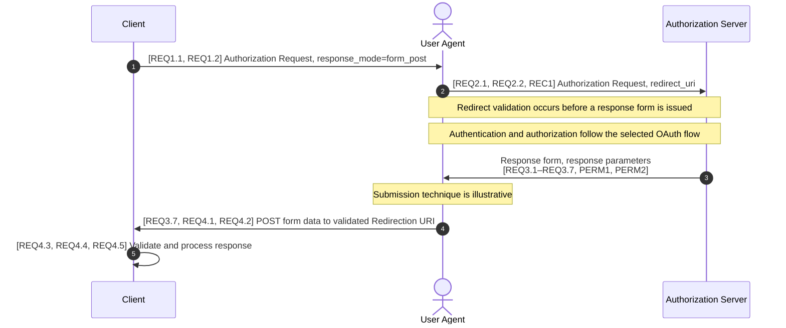

# OAuth 2.0 Form Post Response Mode 1.0 (Modern Spec Edition)

> Working example. This is an unofficial adaptation for guideline evaluation.
> Implementation and interoperability tests have not been run.

## Source and rights notice

This example adapts [OAuth 2.0 Form Post Response Mode, Final, April 27, 2015](https://openid.net/specs/oauth-v2-form-post-response-mode-1_0.html), by Michael B. Jones and Brian Campbell. The OpenID Foundation is the source of the adapted material. This attribution does not imply endorsement by the OpenID Foundation.

Copyright (c) 2015 The OpenID Foundation.

The source's [Appendix C — Notices](https://openid.net/specs/oauth-v2-form-post-response-mode-1_0.html#AppendixC) supplies the applicable copyright permission and other notices. Its copyright grant permits reproduction, preparation of derivative works, distribution, performance, and display solely for developing specifications and implementing Implementers Drafts and Final Specifications based on those documents, subject to attribution without implying endorsement. Consult Appendix C for the full terms, disclaimers, and intellectual property notices.

The repository's CC0 dedication applies only to original contributions to the extent their contributors hold the relevant rights. It does not relicense the underlying specification or other third-party material. Do not treat this entire example as CC0 material.

## 1. Scope

This document specifies the `form_post` Response Mode for OAuth 2.0.
It defines how the AS returns response parameters through an HTML form.

The selected Response Type defines the response parameters and their validation rules.
This document changes their transport, not their meaning.

## 2. Normative references

| Reference | Version / date | Rules used here |
| --- | --- | --- |
| [RFC2119](https://www.rfc-editor.org/rfc/rfc2119.html) | March 1997 | Requirement keywords |
| [RFC8174](https://www.rfc-editor.org/rfc/rfc8174.html) | May 2017 | Uppercase keyword convention |
| [RFC6749](https://www.rfc-editor.org/rfc/rfc6749.html) | October 2012 | Roles; Section 3.1.2: redirect validation; Sections 4.1/4.2: response processing; Section 10.12: CSRF protection |
| [RFC7230](https://www.rfc-editor.org/rfc/rfc7230.html) | June 2014 | User Agent and intermediary terms |
| [HTML401](https://www.w3.org/TR/html401/) | December 1999 | Section 17: form controls and submission; Section 5.3.2: character references |
| [OAuth.Responses](https://openid.net/specs/oauth-v2-multiple-response-types-1_0.html) | February 25, 2014 | Response Mode and `response_mode`; selected Response Type rules |

Other Response Types require their defining specifications.
The examples below use the `code` Response Type from RFC6749.

Uppercase MUST, MUST NOT, SHOULD, and MAY have the meanings defined by RFC2119 and RFC8174.

## 3. Terms and definitions

**3.1 Imported terms**

From RFC6749: Access Token, Authorization Request, Authorization Response, Authorization Server, Client, Protected Resource, Redirection URI, Resource Owner, and Response Type.

From RFC7230: User Agent and intermediary.

From OAuth.Responses: Response Mode.

**3.2 Form Post Response Mode**

A Response Mode that returns parameters through an automatically submitted HTML form.
The form uses HTTP POST and `application/x-www-form-urlencoded` encoding.

## 4. Abbreviations

| Abbreviation | Meaning |
| --- | --- |
| AS | Authorization Server |
| CSRF | Cross-Site Request Forgery |
| HTML | Hypertext Markup Language |
| HTTP | Hypertext Transfer Protocol |
| UA | User Agent |
| URI | Uniform Resource Identifier |

## 5. Actors

**5.1 Target actors**

**Client**: An application that accesses protected resources with the Resource Owner's authorization.
In this mode, the Client requests `form_post` and processes the Authorization Response.

**Authorization Server (AS)**: A server that issues Access Tokens after authenticating the Resource Owner and obtaining authorization.
In this mode, the AS creates the response form.

**5.2 External actors**

**User Agent (UA)**: A browser or similar application that acts on behalf of the Resource Owner.
In this mode, the UA submits the form to the Client.

**Intermediary**: A network component, such as a proxy or cache, that handles HTTP messages between actors.

This document places requirements on the Client and AS.
It does not guarantee that external actors obey instructions.

## 6. Goal and security limits

The goal is to carry response parameters in a POST body.
This avoids putting those parameters in the response destination's query or fragment.
An existing query component of the Redirection URI is not removed.

The response body can still appear in logs or browser tools.
POST does not replace TLS, redirect validation, response validation, or CSRF protection.
A received form is not proof that the AS sent it.

## 7. Interactions

This diagram is informative.
Message numbers are the step references used below.
Notes are not numbered steps.



Steps 3–5 apply only after redirect validation succeeds.
An invalid URI prevents automatic redirection under `REQ2.2`.
A valid URI can receive an OAuth error response in Step 3.
Error handling follows the selected OAuth flow.

## 8. Variable constraints

**8.1 Value notation**

Backticks mark literal text in prose.
They are not part of a value.
HTML attribute quotes delimit markup; they are not part of the decoded value.
A quote inside data is a separate character.
HTML escaping and form encoding preserve the data through different representations.

Case rules apply to each field separately.
The `response_mode` value below is case-sensitive.
HTML attribute syntax follows HTML401.

**8.2 Constraints**

| Variable / Parameter | Context | Sequence Step & Provisions | Type | Presence | Allowed Values | Disallowed Values |
| --- | --- | --- | --- | --- | --- | --- |
| `response_mode` | Requesting this mode | Steps 1–2; `REQ1.1`, `REQ1.2` | String | Required for this request | Exact `form_post` | Any other value for this request |
| `redirect_uri` | Authorization Request | Step 2; `REQ2.1`, `REQ2.2` | URI | Per RFC6749 Section 3.1.2.3 | URI permitted by the applicable registration rules | URI that fails those rules |
| `action` | Response form | Steps 3–4; `REQ3.2` | URI | Required | Client's validated Redirection URI | Another destination |
| `method` | Response form | Steps 3–4; `REQ3.3` | HTML method | Required | POST, with HTML case rules | A different method |
| Response parameters | Form controls, then decoded POST fields | Steps 3–5; `REQ3.1`, `REQ4.2`, `REQ4.3` | Per Response Type | Per selected flow | Names and values permitted by that flow | Values prohibited by that flow |
| Submission media type | POST body | Step 4; `REQ3.7`, `REQ4.1` | Media type | Required | `application/x-www-form-urlencoded` | Another form encoding |
| Cache instructions | AS response | Step 3; `REQ3.4`, `REQ3.5` | HTTP directives | Required | Instructions against storage and reuse | Missing instructions |

The response parameter set is not a fixed list in this document.
Unspecified inputs need the rules of the applicable parameter or flow.
The HTML examples use hidden inputs; other valid form controls are not excluded here.

## 9. Provisions

**9.1 Requesting the mode (Steps 1–2)**

**REQ1.1**: To request this mode, the Client MUST include `response_mode` in the Authorization Request.

**REQ1.2**: For this mode, the Client MUST set `response_mode` to `form_post`.

**9.2 Checking the destination (Step 2)**

These provisions use RFC6749 Sections 3.1.2.3 and 3.1.2.4.

**REQ2.1**: The AS MUST validate the Redirection URI under RFC6749 Section 3.1.2.

**REQ2.2**: If `REQ2.1` fails, the AS MUST NOT automatically redirect the UA to the invalid URI.

**REC1**: If `REQ2.1` fails, the AS SHOULD inform the Resource Owner of the error.

**9.3 Creating the response (Step 3)**

These provisions apply when the AS returns a response using this mode.

**REQ3.1**: The AS MUST encode the response parameters as HTML form values.

**REQ3.2**: The AS MUST set the form's `action` to the Client's validated Redirection URI.

**REQ3.3**: The AS MUST set the form's `method` to POST.

**REQ3.4**: The AS MUST instruct the UA not to store or reuse the response.

**REQ3.5**: The AS MUST instruct intermediaries not to store or reuse the response.

**REQ3.6**: The AS MUST provide automatic submission of the response form.

**REQ3.7**: The AS MUST configure form submission to use `application/x-www-form-urlencoded` encoding.

**PERM1**: The AS MAY use any submission technique supported by the UA.

**PERM2**: The AS MAY include form content needed by that technique.

Submit controls can provide a manual fallback.
The fallback does not remove `REQ3.6`.
No particular script, input type, or HTTP status is required by these provisions.

**9.4 Receiving the response (Steps 4–5)**

**REQ4.1 (Step 4)**: The Client MUST support form-encoded POST responses at its Redirection URI.

**REQ4.2 (Step 4)**: The Client MUST decode the POST body as form data.

**REQ4.3 (Step 5)**: The Client MUST validate the decoded response under the selected Response Type's rules.

**REQ4.4 (Step 5)**: The Client MUST process a valid response regardless of the form submission technique.

**REQ4.5 (Step 5)**: If `REQ4.3` fails, the Client MUST NOT treat the response as a successful authorization.

For `code`, RFC6749 Sections 4.1.2 and 4.1.2.1 define success and error responses.
Section 10.12 defines CSRF protection.
An untrusted response does not become valid merely because it is form-encoded.
Transport parsing is separate from accepting a response as valid.

## 10. Wire examples (non-normative)

These are HTTP display excerpts, not complete replayable exchanges.
HTTP framing and the earlier Authorization Request are omitted.
Assume the request used `response_type=code`, `response_mode=form_post`, and the shown `state`.
The destination has passed `REQ2.1`.

**10.1 Success form — Step 3; `REQ3.1`–`REQ3.7`, `PERM1`, `PERM2`**

This example uses JavaScript, hidden controls, and explicit cache headers.
The headers illustrate the cache instructions; they are not a required header template.

```http
HTTP/1.1 200 OK
Content-Type: text/html;charset=UTF-8
Cache-Control: no-cache, no-store
Pragma: no-cache

<html>
  <head><title>Continue</title></head>
  <body onload="document.forms[0].submit()">
    <form method="post" action="https://client.example.org/cb">
      <input type="hidden" name="code" value="SplxlOBeZQQYbYS6WxSbIA">
      <input type="hidden" name="state" value="af0ifjsldkj">
      <noscript><input type="submit" value="Continue"></noscript>
    </form>
  </body>
</html>
```

**10.2 Submitted success — Step 4; `REQ3.7`, `REQ4.1`, `REQ4.2`**

The body below contains 45 ASCII octets, excluding a trailing newline.
The Client still applies `REQ4.3` before treating the response as valid.

```http
POST /cb HTTP/1.1
Host: client.example.org
Content-Type: application/x-www-form-urlencoded

code=SplxlOBeZQQYbYS6WxSbIA&state=af0ifjsldkj
```

**10.3 Access denied — Steps 3–5; `REQ3.1`, `REQ4.2`, `REQ4.3`**

The Resource Owner denies authorization after redirect validation succeeds.
The AS uses the same form mechanism with `error` and `state` controls instead of `code`.
The resulting POST body is:

```text
error=access_denied&state=af0ifjsldkj
```

The Client processes this as an error, not a successful authorization.
If `REQ2.1` fails, this example does not apply; `REQ2.2` governs that failure.

## 11. Test requirements (non-normative)

These cases check provisions; they do not add protocol requirements.
Full HTTP messages are not needed for each case.

| ID | Setup / input | Observation and expected result | Step & provision |
| --- | --- | --- | --- |
| T1 | Client requests this mode | Request contains `response_mode=form_post` | Steps 1–2; `REQ1.1`, `REQ1.2` |
| T2 | Client requests this mode but emits `FORM_POST`, an empty value, or surrounding data quotes | Generated request fails the Client requirement; no AS rejection rule is inferred | Steps 1–2; `REQ1.2` |
| T3 | AS receives a mismatching Redirection URI | No automatic redirection to that URI | Step 2; `REQ2.1`, `REQ2.2` |
| T4 | AS creates a response form | Parsed action is the validated destination; submission method is POST | Step 3; `REQ3.2`, `REQ3.3` |
| T5 | AS returns a response form | Response instructs UA and intermediaries against storage and reuse; external compliance is not assumed | Step 3; `REQ3.4`, `REQ3.5` |
| T6 | AS returns a response form | Form provides automatic submission with form encoding | Steps 3–4; `REQ3.6`, `REQ3.7` |
| T7 | Equivalent valid responses in separate requests, automatic and manual submission | Client processes both with the same validation result | Steps 4–5; `REQ4.1`–`REQ4.4` |
| T8 | Error body from Section 10.3; outstanding request has matching state | Client handles an authorization error, not success | Step 5; `REQ4.3` |
| T9 | Valid response with `state` different from the outstanding request | Response fails the state validation; POST transport does not bypass it | Step 5; `REQ4.3`, `REQ4.5`; RFC6749 Sections 4.1.2 and 10.12 |
| T10 | Empty `code` in a code response | Empty value fails the nonempty code syntax; the response is not a valid success response | Step 5; `REQ4.3`, `REQ4.5`; RFC6749 Section 4.1.2 and Appendix A.11 |

**11.1 Encoding vectors — Steps 3–4; `REQ3.1`, `REQ4.2`**

These vectors test serialization only.
They use `sample`, an illustrative field, not a new OAuth parameter.
A decoded field still needs the validation rules of its protocol parameter.

| Case | Input string | HTML attribute | Form body | Decoded string |
| --- | --- | --- | --- | --- |
| Quotes and ampersand | `a"b&c` | `value="a&quot;b&amp;c"` | `sample=a%22b%26c` | `a"b&c` |
| Space and plus | `a + b` | `value="a + b"` | `sample=a+%2B+b` | `a + b` |
| Empty boundary | Empty string | `value=""` | `sample=` | Empty string |

**11.2 Evaluation status**

This revision applies the guideline at commit `77ec021`.
One Codex assistant revised the example using the listed references.
The runtime identified the model as `gpt-6.1-sol`.
Sampling settings were not available.

Static document and encoding checks are recorded in the PR.
Implementations and AI-generated test requirements have not been compared.
The multi-model interoperability evaluation required before a final version remains pending.
