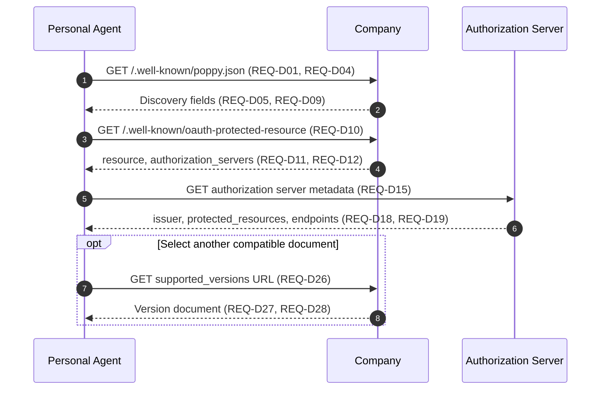
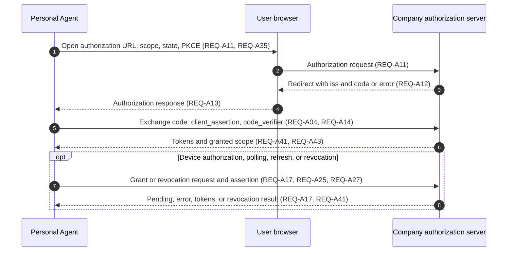
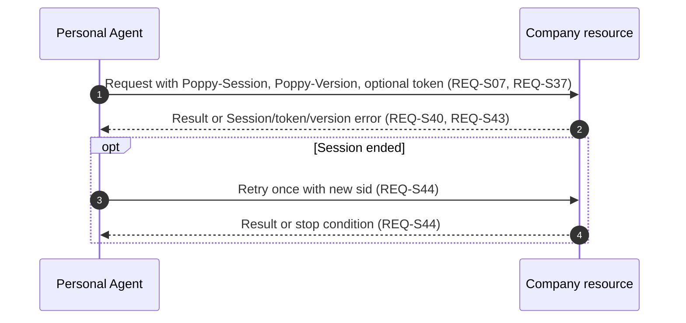
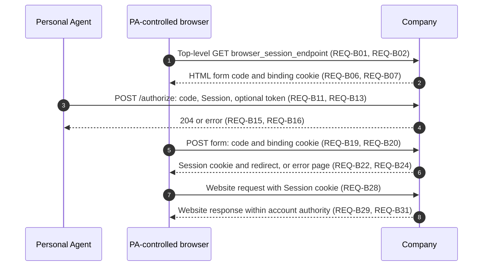
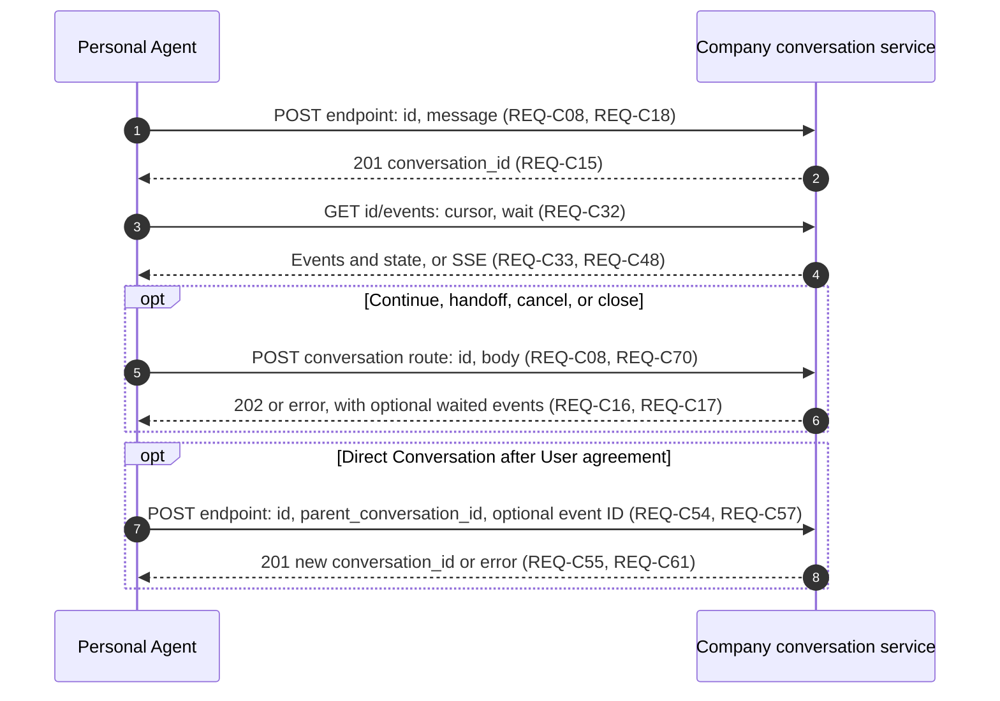
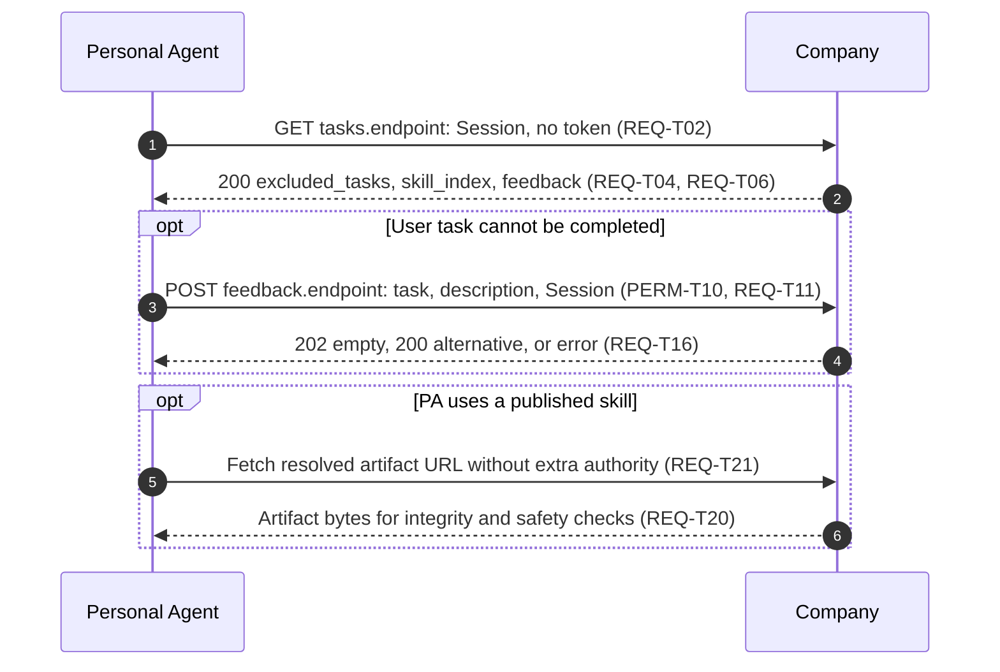

# Personal Agent Protocol — Modern Spec Writing exercise

> Unofficial editorial adaptation of draft 1.0. Changed on 2026-11-13.
> This exercise is for review. It is not an approved protocol specification.
> Implementation, interoperability, and formal ASD-STE100 checks have not been run.

## Source and rights

Adapted from the [Personal Agent Protocol specification, draft 1.0](https://personalagentprotocol.org/docs/1.0/spec), published by the Personal Agent Protocol project.
The specification and its examples are under the [Apache License 2.0](licenses/personal-agent-protocol-Apache-2.0.txt).
The source's [license notice](https://personalagentprotocol.org/license) excludes the protocol names, logo, and site design from its license.
Use of the names here identifies the source; it does not imply endorsement.
The repository's CC0 dedication does not relicense the adapted material.

The source Markdown was retrieved on 2026-11-13 from `https://personalagentprotocol.org/docs/1.0/spec.md`.
Its SHA-256 was `f6644ed6a6df228a5711ae8bff80f0b4202e0a639e1cbd9031e685c03dbc61b4`.
The draft can change without backward compatibility.
This document reorganizes and shortens it. It does not intentionally change protocol behavior.
Review questions are in Section 16. They are not new protocol rules.
No provision-to-source mapping is maintained.

## 1. Scope

This document specifies how a Personal Agent acts for one User at a Company.
It covers discovery, identity, account access, Sessions, web browsing, APIs, conversations, task information, and feedback.
Extensions define additional features. Their internal behavior is outside this document.

A Session connects activity across channels. OAuth grants account access.
A signed-out Session does not require an authorization server.
A signed-in request uses both a Session header and an access token.
OAuth endpoints use client authentication instead of the Session header.
A browser uses Company cookies after browser join.
A website request from an HTTP client is signed out, even if a joined browser is signed in.

**Example conventions**

All examples in this document are illustrative. They add no requirements.
`example.com` is the Company; `agent.example` is the PA.
`{SESSION_JWT}` and `{ACCESS_TOKEN}` are placeholders for complete credentials.
They are not literal wire values. `bc_001` also stands for a complete, unguessable join code.
Valid signatures and unrelated headers are omitted.
Decoded JWT examples are not compact JWTs.
HTTP field and JSON encoding follow the references identified in Section 2.
No `Content-Length` is given, so placeholder lengths do not assert a false byte count.

## 2. Normative references

The following references supply the rules identified in the last column.
An RFC number identifies the published RFC, not its later replacements.
The source does not pin several Internet-Drafts or living specifications; see Section 16.

<a id="table-1"></a>
**Table 1 — Normative references**

| Reference | Version | Rules used |
| --- | --- | --- |
| [RFC 2119](https://www.rfc-editor.org/rfc/rfc2119), [RFC 8174](https://www.rfc-editor.org/rfc/rfc8174) | Published RFCs | Uppercase requirement keywords |
| [RFC 6749](https://www.rfc-editor.org/rfc/rfc6749) | OAuth 2.0 | Grants, tokens, scope syntax, token errors, refresh |
| [RFC 6750](https://www.rfc-editor.org/rfc/rfc6750) | Bearer token usage | Authorization header and challenges |
| [RFC 7009](https://www.rfc-editor.org/rfc/rfc7009) | Token revocation | Revocation requests and effects |
| [RFC 8414](https://www.rfc-editor.org/rfc/rfc8414) | Authorization server metadata | Metadata fields and discovery URL |
| [RFC 9728](https://www.rfc-editor.org/rfc/rfc9728) | Protected resource metadata | Resource discovery, matching, challenges, `protected_resources` |
| [RFC 7636](https://www.rfc-editor.org/rfc/rfc7636), [RFC 8252](https://www.rfc-editor.org/rfc/rfc8252), [RFC 9207](https://www.rfc-editor.org/rfc/rfc9207) | Published RFCs | PKCE; native app redirect URIs; issuer in authorization responses |
| [RFC 8628](https://www.rfc-editor.org/rfc/rfc8628), [RFC 10027](https://www.rfc-editor.org/rfc/rfc10027) | Published RFCs | Device grant and cross-device security practices |
| [RFC 9700](https://www.rfc-editor.org/rfc/rfc9700) | OAuth Security BCP | OAuth security, exact redirect matching, minimum scope |
| [CIMD](https://datatracker.ietf.org/doc/draft-ietf-oauth-client-id-metadata-document/) | Draft; revision unspecified | Client metadata document; fetch without redirects |
| [RFC 7523](https://www.rfc-editor.org/rfc/rfc7523), [7523bis](https://datatracker.ietf.org/doc/draft-ietf-oauth-rfc7523bis/) | RFC; draft revision unspecified | Client assertions; issuer audience |
| [OpenID Connect Core](https://openid.net/specs/openid-connect-core-1_0.html#SubjectIDTypes) | 1.0, Section 8 | Pairwise identifier concept; assignment differs here |
| [RFC 9449](https://www.rfc-editor.org/rfc/rfc9449), [RFC 8707](https://www.rfc-editor.org/rfc/rfc8707) | Published RFCs | DPoP; resource indicators |
| [RFC 8725](https://www.rfc-editor.org/rfc/rfc8725), [RFC 7800](https://www.rfc-editor.org/rfc/rfc7800), [RFC 7638](https://www.rfc-editor.org/rfc/rfc7638) | Published RFCs | JWT type separation; confirmation key; JWK thumbprint |
| [RFC 9474](https://www.rfc-editor.org/rfc/rfc9474) | RSABSSA | Blind signing, including Section 7.3 |
| [RFC 9421](https://www.rfc-editor.org/rfc/rfc9421), [Web Bot Auth](https://datatracker.ietf.org/doc/draft-ietf-webbotauth-httpsig-protocol/) | RFC; draft revision unspecified | Optional operator signatures |
| [RFC 9110](https://www.rfc-editor.org/rfc/rfc9110), [RFC 9111](https://www.rfc-editor.org/rfc/rfc9111), [RFC 6585](https://www.rfc-editor.org/rfc/rfc6585) | Published RFCs | HTTP, caching, rate limits, `Retry-After` |
| [Cookies](https://datatracker.ietf.org/doc/draft-ietf-httpbis-rfc6265bis/) | Draft; revision unspecified | Browser cookie behavior |
| [RFC 3986](https://www.rfc-editor.org/rfc/rfc3986), [RFC 4648](https://www.rfc-editor.org/rfc/rfc4648) | Published RFCs | URI resolution and host case; URL-safe alphabet; base64url |
| [RFC 3339](https://www.rfc-editor.org/rfc/rfc3339), [RFC 5646](https://www.rfc-editor.org/rfc/rfc5646) | Published RFCs | Event timestamps; language tags |
| [RFC 9651](https://www.rfc-editor.org/rfc/rfc9651) | Structured Fields | List of Strings and String parameters |
| [RFC 9745](https://www.rfc-editor.org/rfc/rfc9745), [RFC 8594](https://www.rfc-editor.org/rfc/rfc8594) | Published RFCs | Deprecation and Sunset headers |
| [OpenAPI](https://spec.openapis.org/oas/v3.1.1.html) | 3.1.1; source also accepts 3.0 descriptions | API description, security, scope descriptions |
| [MCP](https://modelcontextprotocol.io/specification/2025-06-18), [MCP](https://modelcontextprotocol.io/specification/2026-07-28) | 2025-06-18 and 2026-07-28 | Streamable HTTP, authorization, tool descriptions, transport lifecycle |
| [JSON Schema](https://json-schema.org/draft/2020-12) | 2020-12 | Extension message content schemas |
| [SSE](https://html.spec.whatwg.org/multipage/server-sent-events.html) | HTML Living Standard | Event streams and reconnect behavior |
| [Agent Skills](https://agentskills.io/specification) | Living specification | Skill format |
| [Skills discovery proposal](https://github.com/jonathanhefner/agentskills/blob/ab2ff8db3d5c9597985b06f94ea3caf1996ce82e/docs/well-known-uri.mdx) | Commit `ab2ff8db3d5c9597985b06f94ea3caf1996ce82e`, schema 0.2.0 | Index, artifact distribution, integrity, HTTP, archive safety |
| [WIMSE AIMS](https://datatracker.ietf.org/doc/draft-ietf-wimse-aims/) | Draft; revision unspecified, Section 8 | Credentials outside model context |

The source also cites [UCP version selection](https://ucp.dev/latest/specification/overview/#version-selection) as background and the [Idempotency-Key draft](https://datatracker.ietf.org/doc/draft-ietf-httpapi-idempotency-key-header/) for an illustrative API request.
Neither defines conversation request-ID behavior here.

MUST, MUST NOT, SHOULD, SHOULD NOT, and MAY use the meanings in RFC 2119 and RFC 8174.
`REQ`, `REC`, and `PERM` identify requirements, recommendations, and permissions.
Value tables state input and output constraints. They do not assign an unspecified failure response.

## 3. Terms and definitions

From RFC 6749: client, authorization server, access token, refresh token, scope, authorization code.
From RFC 9110: user agent, intermediary.
From RFC 9449: DPoP proof.

<a id="table-2"></a>
**Table 2 — Terms and definitions**

| Term | Meaning |
| --- | --- |
| User | Person for whom a Personal Agent acts |
| Personal Agent | Software that acts for one User in an interaction |
| Company | Entity that offers protocol interfaces |
| Company Agent | Company's agent reached through a conversation protocol |
| Company identifier | OAuth issuer, if present; otherwise `https://{organization.domain}` with a lowercase host and no trailing slash |
| User ID | Personal Agent's opaque identifier for a User at one Company |
| Agent ID | Identifier for one of the operator's agents acting for a User at one Company |
| Session | User activity at one Company through one Personal Agent |
| Session header | `Poppy-Session`, containing a request-specific signed JWT |
| Delegated key | Key whose public part is carried in a signed delegation |
| Delegation | JWT that certifies a delegated key |
| Direct Sign-In | User authorization through an authorization code flow |
| Device Sign-In | User authorization through a device authorization flow |
| Sign-out | Revocation of the Personal Agent's refresh tokens for an account |
| Signed out | Request without an access token; pseudonymous activity can remain identifiable by User ID |
| Conversation ID | Identifier for one conversation |
| Direct Conversation | Separate conversation linked to a parent, through which the User speaks with the Company |
| Cursor | Opaque position in the conversation's event list |

## 4. Abbreviations and notation

<a id="table-3"></a>
**Table 3 — Abbreviations and notation**

| Symbol | Meaning |
| --- | --- |
| API | Application programming interface |
| AS | Company's authorization server |
| CIMD | Client ID Metadata Document |
| DPoP | Demonstrating Proof of Possession |
| HTTPS | HTTP over TLS |
| JSON | JavaScript Object Notation |
| JWK / JWKS | JSON Web Key / JSON Web Key Set |
| JWT | JSON Web Token |
| MCP | Model Context Protocol |
| PA | Personal Agent |
| PKCE | Proof Key for Code Exchange |
| SSE | Server-sent events |
| `{domain}` | Host that serves the final well-known discovery document |
| `{endpoint}` | Selected `poppy` conversation endpoint |
| `{id}` | Conversation ID in a route |
| Figure number | Number that identifies a sequence diagram |
| Message number | Automatically numbered message within a sequence diagram |

Code formatting marks data names and values.
JSON quotation marks delimit strings; they are not part of the decoded value.
Structured Fields quotation marks delimit Strings and String parameters under RFC 9651.
OAuth scope strings contain space-separated scope tokens under RFC 6749 Section 3.3.
ID length limits apply to the ASCII alphabet in Section 12, not to a decoded base64 byte string.

## 5. Actors and conformance

<a id="table-4"></a>
**Table 4 — Actors and conformance roles**

| Actor | Definition | Conformance role |
| --- | --- | --- |
| Personal Agent (PA) | Software that acts for the User at a Company | Implements PA requirements |
| Company | Entity that offers protocol interfaces | Implements Company requirements for its offered features |
| Authorization server (AS) | Company service that authorizes account access and issues tokens | Performs Company duties for OAuth |
| API server | Company service that handles API requests | Performs Company duties for its API |
| Conversation service | Company service that manages conversations and events | Performs Company duties for conversations |
| Company Agent | Company's agent that communicates through a conversation service | Performs Company duties for its messages and actions |
| Browser-session service | Company service that joins a browser to a Session | Performs Company duties for browser join |
| Extension author | Party that defines an extension's name, versions, and schemas | Implements extension-definition requirements |
| User | Person for whom the PA acts | External actor |
| User's browser | Browser through which the User interacts with sign-in pages | External actor |
| PA-controlled browser | Browser the PA controls for website activity, including a headless browser | External actor controlled by the PA |
| Model | AI component that processes content for an agent | External actor |
| Shared cache | Intermediary that stores responses for reuse by multiple clients | External actor |
| Traffic intermediary | Network component that handles requests before they reach a Company service | External actor |

A PA or Company controls the messages and checks assigned to it; it does not control all external actors.

Conformance depends on the channels and optional features an implementation offers.
An implementation need not offer every channel, sign-in flow, extension, or streaming.
The requirements for a feature apply when the implementation offers or uses it.

## 6. Goal and security limits

The goal is consistent User activity across Company interfaces, with separate identity and account authorization.
The Company chooses which clients and requests to accept.
Its approval policy is outside this protocol.

Discovery proves control of a host and checks the host–issuer relationship.
It does not prove that a display name or logo identifies the organization the User intended.
A malicious domain can publish valid metadata with a copied name.
Endpoints can be on other hosts. Their publication does not establish that those hosts are trustworthy.

A verified Session JWT identifies a client and pseudonymous User; it grants no account access.
Token binding through the Session JWT applies only where the Company verifies it.
OAuth validation, scope checks, and required DPoP checks still apply where Session verification is omitted.
Operator signatures authenticate their key source; they do not validate arbitrary Session claims.

Browser join depends on code secrecy, cookie binding, browser isolation, and the PA using its own browser.
Cross-device sign-in can be approved by a person other than the User who started it.
A valid redirect or device poll does not identify the person who approved it.

## 7. Discovery and version selection

### 7.1 Interaction

This diagram shows an issuer-backed discovery path.
The no-issuer path omits AS metadata after the conditions in `REQ-D11` hold.
References to Figure 1 identify this diagram and its numbered messages.
Local checks use the response step that supplies their input.

<a id="figure-1"></a>
**Figure 1 — Discovery and version selection**



### 7.2 Discovery provisions

**REQ-D01 ([Figure 1](#figure-1), Messages 1–2)**: The Company MUST publish `poppy.json` at `https://{domain}/.well-known/poppy.json` on a domain or subdomain it controls.

**REQ-D02 ([Figure 1](#figure-1), Messages 1–2)**: The PA MUST follow discovery redirects only to HTTPS URLs.

**PERM-D03 ([Figure 1](#figure-1), Messages 1–2)**: The Company MAY redirect the well-known URL to another host.

**REQ-D04 ([Figure 1](#figure-1), Message 2)**: The PA MUST use the final discovery document only if its path is exactly `/.well-known/poppy.json` and its URL has no query.

**REQ-D05 ([Figure 1](#figure-1), Message 2)**: The PA MUST check that `organization.domain` equals the final serving host, ignoring case with no other normalization.

**REQ-D06 ([Figure 1](#figure-1), Messages 1–8)**: Each PA and Company MUST use HTTPS for protocol URLs in metadata, extensions, assertions, Session JWTs, and responses.

**REQ-D07 ([Figure 1](#figure-1), Messages 1–8)**: The PA MUST NOT use a Company protocol URL with another scheme.

**REQ-D08 ([Figure 1](#figure-1), Messages 1–8)**: The Company MUST reject a PA protocol URL with another scheme.

The HTTPS rule excludes ordinary website pages and permitted loopback redirect URIs.
Skill references are resolved before the rule applies.
The final serving host is the domain represented by the document.

**REQ-D09 ([Figure 1](#figure-1), Message 2)**: The Company MUST supply the required discovery fields in Section 7.5.

[Example 3](#example-3) shows a signed-out discovery document.

**REQ-D10 ([Figure 1](#figure-1), Messages 3–4)**: A Company with an issuer MUST publish protected resource metadata for `https://{organization.domain}`, with that exact `resource` value.

**REQ-D11 ([Figure 1](#figure-1), Message 4)**: The PA MUST use the domain identifier fallback only after HTTP 404, or valid metadata with no authorization servers, when `auth.issuer` is absent and sign-in is not offered.

**REQ-D12 ([Figure 1](#figure-1), Message 4)**: The PA MUST NOT fall back after timeout, another error status, invalid metadata, or issuer verification failure.

**REQ-D13 ([Figure 1](#figure-1), Message 4)**: A PA that knows an issuer MUST NOT replace it with the fallback unless successful discovery explicitly establishes issuer removal.

With one listed authorization server, that server is the issuer.
With several servers, `auth.issuer` selects the issuer for all PAs.

**REQ-D14 ([Figure 1](#figure-1), Messages 5–6)**: A Company that offers sign-in MUST have an OAuth issuer.

**REQ-D15 ([Figure 1](#figure-1), Messages 5–6)**: The Company MUST publish AS metadata at the RFC 8414 Section 3.1 URL.

**REQ-D16 ([Figure 1](#figure-1), Message 6)**: The Company MUST list `https://{domain}` for each represented domain in `protected_resources`, without a path, port, or trailing slash.

**PERM-D17 ([Figure 1](#figure-1), Message 6)**: The Company MAY also list other protected resources.

**REQ-D18 ([Figure 1](#figure-1), Message 6)**: The PA MUST compare the metadata's `issuer` with the discovered issuer character for character before using the discovery document.

**REQ-D19 ([Figure 1](#figure-1), Message 6)**: The PA MUST check that `protected_resources` includes `https://{organization.domain}` under RFC 9728 Section 3.3, after lowercasing the host.

**REQ-D20 ([Figure 1](#figure-1), Messages 2–6)**: A Company with several domains and one issuer MUST select that issuer on every domain.

**REQ-D21 ([Figure 1](#figure-1), Messages 2–6)**: A provider for several Companies MUST assign a separate issuer to each Company.

Domains with one issuer share User IDs, Sessions, and refresh tokens.
A Company without an issuer has a separate identity for each domain.
If the Company identifier changes, identity does not transfer automatically.

**REQ-D22 ([Figure 1](#figure-1), Messages 2–6)**: On a Company identifier change, the PA MUST use new User IDs, Agent IDs, and Sessions.

**REQ-D23 ([Figure 1](#figure-1), Messages 2–6)**: The Company MUST give each scope the same authorization meaning across domains that share its issuer.

**REC-D24 ([Figure 1](#figure-1), Messages 2–6)**: The Company SHOULD publish the same scope descriptions and hints across these domains.

Capabilities and other fields can differ by domain. The PA uses the document for the domain where it is working.

### 7.3 Versions and extensions

**REQ-D25 ([Figure 1](#figure-1), Message 2, [Figure 1](#figure-1), Messages 7–8)**: The PA MUST select the newest advertised version compatible with a version it implements.

Versions are compatible when their major versions match and, before 1.0, their minor versions also match.

**REQ-D26 ([Figure 1](#figure-1), Messages 7–8)**: The PA MUST NOT use a `supported_versions` URL on another host or follow a redirect from it.

**REQ-D27 ([Figure 1](#figure-1), Message 8)**: The PA MUST NOT use an alternate document whose `protocol_version` differs from its advertised version.

An alternate document has no `supported_versions`. Its path need not be the well-known path.

**REQ-D28 ([Figure 1](#figure-1), Message 2, [Figure 1](#figure-1), Message 8)**: The Company MUST give simultaneously served version documents the same `organization.domain` and selected issuer.

**REQ-D29 ([Figure 1](#figure-1), Message 2, [Figure 1](#figure-1), Message 8)**: If `REQ-D25` finds no compatible version, the PA MUST NOT use any advertised document.

**REQ-D30 ([Figure 3](#figure-3), Message 1)**: On every request with a Session header, the PA MUST send its implemented compatible version as `Poppy-Version: major.minor`.

**REQ-D31 ([Figure 3](#figure-3), Message 1)**: When declaring extensions, the PA MUST encode `Poppy-Extensions` as an RFC 9651 List of Strings, with one selected version per extension in its String `v` parameter.

An extension identifiable from the request itself, such as a grant type, needs no declaration.
Absent or unparsable `Poppy-Extensions` declares no extensions.
Discovery and OAuth requests do not carry these version headers.

**REQ-D32 ([Figure 3](#figure-3), Message 1)**: The PA MUST keep version and extension header values unchanged throughout a Session.

**REQ-D33 ([Figure 3](#figure-3), Message 1)**: To change the values in `REQ-D32`, the PA MUST start a new Session.

**REQ-D34 ([Figure 3](#figure-3), Message 1)**: An endpoint that verifies Sessions MUST also check `Poppy-Version` for presence and compatibility with a served version.

**REQ-D35 ([Figure 3](#figure-3), Message 2)**: If `REQ-D34` fails, the Company MUST return HTTP 400 with JSON `error` set to `version_unsupported`.

[Example 1](#example-1) shows an unsupported-version response.

**REQ-D36 ([Figure 3](#figure-3), Messages 1–2)**: If `REQ-D34` fails, the Company MUST NOT handle the request under another version.

**REQ-D37 ([Figure 1](#figure-1), Messages 1–8, [Figure 3](#figure-3), Message 2)**: On `version_unsupported`, the PA MUST repeat discovery without a cached `poppy.json`.

**REQ-D38 ([Figure 3](#figure-3), Messages 1–2)**: If rediscovery selects another version, the PA MUST retry once in a new Session.

**REQ-D49 ([Figure 3](#figure-3), Messages 1–2)**: If rediscovery selects no other version, the PA MUST stop the request.

**PERM-D39 ([Figure 3](#figure-3), Message 2)**: The Company MAY announce version removal with `Deprecation` and `Sunset` headers.

<a id="example-1"></a>
**Example 1 — Unsupported version (non-normative)**

[Figure 3](#figure-3), Message 2; `REQ-D35`: missing or incompatible version at a Session-verifying endpoint.

```http
HTTP/1.1 400 Bad Request
Content-Type: application/json

{"error":"version_unsupported"}
```

**End of Example 1.**

From 1.0, discovery location and fetching, version fields and headers, and `version_unsupported` retain their meaning across versions.

**REQ-D40 ([Figure 1](#figure-1), Message 2)**: An extension author outside this protocol MUST prefix its extension name with a domain it controls.

Plain names are reserved for protocol-defined extensions.
Each advertised extension entry has a major `version`. Incompatible changes use another major version.
The extension defines its other fields.

**REQ-D41 ([Figure 1](#figure-1), Message 2, [Figure 3](#figure-3), Messages 1–2)**: Each PA and Company MUST ignore unsupported extensions, unsupported extension versions, and unrecognized extension fields.

**REQ-D42 ([Figure 5](#figure-5), Messages 1–4)**: An extension author that defines message content MUST publish a JSON Schema for that content.

**PERM-D43 ([Figure 3](#figure-3), Message 2)**: The Company MAY refuse a request that needs a listed extension version not declared or otherwise used by the request.

**REQ-D44 ([Figure 3](#figure-3), Message 2)**: A Company that refuses under `PERM-D43` MUST return HTTP 403 with JSON `error: extension_required` and the extension name in `extension`.

[Example 2](#example-2) shows an extension-required response.

**REQ-D45 ([Figure 3](#figure-3), Message 2)**: The Company MUST NOT put `extension_required` in `WWW-Authenticate`.

<a id="example-2"></a>
**Example 2 — Required extension (non-normative)**

[Figure 3](#figure-3), Message 2; `REQ-D44`: an undeclared extension required for this request.

```http
HTTP/1.1 403 Forbidden
Content-Type: application/json

{"error":"extension_required","extension":"example.com/gift-wrap"}
```

**End of Example 2.**

### 7.4 Sign-in disabled

A Company with an issuer can set `auth.disabled: true` while retaining its issuer identity.
Existing refresh tokens work until revoked.

**REQ-D46 ([Figure 2](#figure-2), Messages 1–8)**: The PA MUST NOT start Direct, Device, or Mediated Sign-In when `auth.disabled` is true.

**REQ-D47 ([Figure 1](#figure-1), Message 2)**: A Company with `auth.disabled: true` MUST NOT advertise Mediated Sign-In or `signed_in` access.

**PERM-D48 ([Figure 2](#figure-2), Messages 7–8)**: A Company with disabled sign-in that has never issued a PA refresh token MAY return `invalid_grant` for refresh and success for revocation without verifying the client assertion.

Once it issues a token or enables sign-in, normal assertion verification applies.

### 7.5 Discovery values

[Figure 1](#figure-1), Message 2 supplies these fields. `REQ-D09` governs required presence.
Fields form an extensible document. A blank optional object does not imply a useful channel.
`Unspecified` below means that the source does not give an additional constraint.

<a id="table-5"></a>
**Table 5 — Discovery document values**

| Variable / Parameter | Context | Sequence Step & Provisions | Type | Presence | Allowed Values | Disallowed Values |
| --- | --- | --- | --- | --- | --- | --- |
| `protocol_version` | Discovery | [Figure 1](#figure-1), Message 2, [Figure 1](#figure-1), Message 8; REQ-D25, REQ-D26, REQ-D27, REQ-D28, REQ-D29 | String | Required | `major.minor`; this draft `1.0` | Incompatible selected version |
| `supported_versions` | Main discovery | [Figure 1](#figure-1), Message 2; REQ-D26, REQ-D27, REQ-D28 | Object | Optional; absent in alternate documents | Version keys mapped to HTTPS URLs on final host | Other host; redirected alternate document |
| `organization` | Discovery | [Figure 1](#figure-1), Message 2; REQ-D05, REQ-D09 | Object | Required | `name`, `domain`, optional `logo_uri` | Missing name or domain |
| `organization.name` | Display | [Figure 1](#figure-1), Message 2; REQ-D09 | String | Required | Display name | Unspecified |
| `organization.domain` | Host identity | [Figure 1](#figure-1), Message 2; REQ-D05 | String | Required | Final serving host, case-insensitive comparison only | Different host |
| `organization.logo_uri` | Display | [Figure 1](#figure-1), Message 2; REQ-D06 | URL string | Optional | HTTPS logo URL | Non-HTTPS |
| `auth` | Sign-in | [Figure 1](#figure-1), Message 2; REQ-D09 | Object | Optional | `issuer`, `disabled`, `scopes`, `scope_hints` | Unspecified |
| `auth.issuer` | Issuer selection | [Figure 1](#figure-1), Messages 2–6; REQ-D10, REQ-D11, REQ-D12, REQ-D13, REQ-D14, REQ-D15, REQ-D16, PERM-D17, REQ-D18, REQ-D19 | String | Required with several listed ASs; otherwise optional | Selected listed issuer; sole issuer when only one exists | Unlisted issuer |
| `auth.disabled` | Sign-in | [Figure 1](#figure-1), Message 2; REQ-D46, REQ-D47, PERM-D48 | Boolean | Optional; default false | `true`, `false` | Other types |
| `auth.scopes` | Scope descriptions | [Figure 1](#figure-1), Message 2; REC-A30 | Object | Optional | Scope names mapped to descriptions in OpenAPI scope form | Unspecified |
| `auth.scope_hints` | Scope hints | [Figure 1](#figure-1), Message 2; REQ-A31, REQ-A32, REQ-A33 | Object | Optional | Scope names mapped to both hint fields | Missing hint field in an entry |
| `agent` | Channel | [Figure 1](#figure-1), Message 2; REQ-D09 | Object | At least one of `agent`, `apis`, `web` | `protocols` list with `type` and HTTPS `endpoint` | No channel |
| `agent.protocols[].access` | `poppy` protocol hint | [Figure 1](#figure-1), Message 2; REQ-D14, REQ-D47 | String | Optional; default `session` | `session`, `signed_in`; unknown means no hint | `signed_in` without issuer or with disabled sign-in |
| `apis` | Channel | [Figure 1](#figure-1), Message 2; REQ-D09 | Array | At least one channel | Entries with `type`, `url`, short `description` | No channel |
| `web` | Channel | [Figure 1](#figure-1), Message 2; REQ-D09 | Object | At least one channel | Browser settings | No channel |
| `web.browser_session_endpoint` | Browser join | [Figure 1](#figure-1), Message 2; REQ-B01, REQ-B02, REQ-B03, REQ-B04, REC-B05 | HTTPS URL | Optional | Endpoint selected for this version | Present with `web.disabled: true` |
| `web.disabled` | Browser preference | [Figure 1](#figure-1), Message 2; REQ-B04 | Boolean | Optional; default false | `true`, `false` | Other types |
| `web.unscoped` | Website authorization | [Figure 1](#figure-1), Message 2; REQ-B33, REQ-B34, REQ-B35 | Boolean | Optional; default false | `true`, `false` | True without browser endpoint |
| `tasks.endpoint` | Tasks discovery | [Figure 1](#figure-1), Message 2; REQ-T01 | HTTPS URL | Required when offering tasks, skills, or feedback | Tasks endpoint | Non-HTTPS |
| `extensions` | Extension discovery | [Figure 1](#figure-1), Message 2; REQ-D40, REQ-D41, REQ-D42 | Object | Optional | Names mapped to arrays of major-version entries | Unqualified third-party name |

The PA ignores an unknown `access` hint. The hint does not grant authorization.
OpenAPI security requirements and MCP authorization supply their own account-access information.

<a id="example-3"></a>
**Example 3 — Signed-out discovery document (non-normative)**

[Figure 1](#figure-1), Message 2; `REQ-D01`, `REQ-D09`, `REQ-D25`.
This body advertises a signed-out conversation channel.
An HTTP 404 protected resource discovery result establishes the no-issuer case under `REQ-D11`.

```json
{
  "protocol_version": "1.0",
  "organization": { "name": "Example Company", "domain": "example.com" },
  "agent": {
    "protocols": [
      { "type": "poppy", "endpoint": "https://example.com/conversations" }
    ]
  }
}
```

**End of Example 3.**

### 7.6 AS metadata values

<a id="table-6"></a>
**Table 6 — Authorization server metadata values**

| Variable / Parameter | Context | Sequence Step & Provisions | Type | Presence | Allowed Values | Disallowed Values |
| --- | --- | --- | --- | --- | --- | --- |
| `issuer` | AS metadata | [Figure 1](#figure-1), Message 6; REQ-D18 | String | Required | Exact discovered issuer | Any different value |
| `protected_resources` | AS metadata | [Figure 1](#figure-1), Message 6; REQ-D16, REQ-D19 | Array of URL strings | Required | Every represented domain resource; other resources permitted | Omission of represented domain |
| `token_endpoint` | Token exchange | [Figure 1](#figure-1), Message 6, [Figure 2](#figure-2), Messages 5–8; REQ-D15 | HTTPS URL | Required | Token endpoint | Non-HTTPS |
| `revocation_endpoint` | Revocation | [Figure 1](#figure-1), Message 6, [Figure 2](#figure-2), Messages 7–8; REQ-D15 | HTTPS URL | Required | Revocation endpoint | Non-HTTPS |
| `grant_types_supported` | Grants | [Figure 1](#figure-1), Message 6; REQ-D15 | Array of strings | Required | Includes `refresh_token`; can include `authorization_code` and device grant URN | Missing `refresh_token` |
| `authorization_endpoint` | Direct Sign-In | [Figure 1](#figure-1), Message 6, [Figure 2](#figure-2), Message 1; REQ-A11 | HTTPS URL | Required when code grant is listed | Authorization endpoint | Non-HTTPS |
| `device_authorization_endpoint` | Device Sign-In | [Figure 1](#figure-1), Message 6, [Figure 2](#figure-2), Message 7; REQ-A17 | HTTPS URL | Required when device grant is listed | Device endpoint | Non-HTTPS |
| `scopes_supported` | Scopes | [Figure 1](#figure-1), Message 4, [Figure 1](#figure-1), Message 6; REC-A29 | Array of strings | Recommended at domain or AS, or both | Requestable scopes; can omit scopes for other clients | Unspecified |
| `token_endpoint_auth_signing_alg_values_supported` | Client assertions | [Figure 1](#figure-1), Message 6; REQ-A08 | Array of strings | Optional | Assertion algorithms | Does not declare delegation support |

The PA ignores other AS metadata fields.

## 8. Account access

### 8.1 Interactions

Direct Sign-In uses the authorization code grant with PKCE.
The PA is a confidential OAuth client.
Messages 1–6 in Figure 2 show Direct Sign-In. Messages 7–8 summarize other OAuth exchanges.
The User's browser is external; the PA opens a URL and receives a response.

<a id="figure-2"></a>
**Figure 2 — Account authorization**



### 8.2 Client identity

**REQ-A01 ([Figure 2](#figure-2), Messages 1–8, [Figure 3](#figure-3), Message 1)**: The PA MUST use an HTTPS client metadata document URL as its `client_id`.

**REQ-A02 ([Figure 2](#figure-2), Message 5, [Figure 2](#figure-2), Message 7, [Figure 3](#figure-3), Message 1)**: The PA MUST set the document's `client_id` to the URL from which it is fetched.

**REQ-A03 ([Figure 2](#figure-2), Message 5, [Figure 2](#figure-2), Message 7, [Figure 3](#figure-3), Message 1)**: The PA MUST publish only public keys at an HTTPS `jwks_uri` on the `client_id` domain.

**REQ-A04 ([Figure 2](#figure-2), Message 5, [Figure 2](#figure-2), Message 7)**: The PA MUST authenticate token requests with `private_key_jwt`, signed by a key in `jwks_uri`.

**REQ-A05 ([Figure 2](#figure-2), Message 5, [Figure 2](#figure-2), Message 7)**: The PA MUST set the assertion's `aud` to the Company's issuer as one string.

**REQ-A06 ([Figure 2](#figure-2), Message 5, [Figure 2](#figure-2), Message 7)**: The Company MUST reject an assertion whose `aud` differs character for character from its issuer, including an audience equal to the token endpoint URL.

**REQ-A07 ([Figure 2](#figure-2), Message 5, [Figure 2](#figure-2), Message 7)**: The PA MUST issue short-lived client assertions with `iat` and a unique, unguessable `jti`, under RFC 7523 Section 3.

**REQ-A08 ([Figure 2](#figure-2), Message 5, [Figure 2](#figure-2), Message 7)**: The Company MUST accept `ES256` client assertions.

**REC-A09 ([Figure 2](#figure-2), Message 5, [Figure 2](#figure-2), Message 7)**: The Company SHOULD accept `PS384` client assertions.

**PERM-A10 ([Figure 2](#figure-2), Message 5, [Figure 2](#figure-2), Message 7)**: The Company MAY reject a reused assertion `jti`.

The Company returns `invalid_client` when refusing a client at the AS.
It returns `invalid_session` when refusing a client at a resource.
It can allow signed-out Sessions but deny sign-in or one grant with `unauthorized_client`.
The PA then continues signed out.
A shared origin does not make two client metadata URLs the same client.

### 8.3 Direct and Device Sign-In

**REQ-A11 ([Figure 2](#figure-2), Messages 1–6)**: The PA and Company MUST use the RFC 6749 authorization code grant with RFC 7636 PKCE and RFC 9700 security rules for Direct Sign-In.

[Example 4](#example-4) shows a Direct Sign-In request.

**REQ-A12 ([Figure 2](#figure-2), Message 3)**: The Company MUST include its issuer as `iss` in every authorization response, including `access_denied`.

**REQ-A13 ([Figure 2](#figure-2), Message 4)**: The PA MUST check that `iss` exactly matches the issuer with which it started sign-in.

**REQ-A14 ([Figure 2](#figure-2), Message 5)**: The PA MUST include its client assertion in the code exchange.

Client metadata `redirect_uris` entries are HTTPS URLs on the client domain, or RFC 8252 Section 7.3 loopback redirect URIs.
The authorization request's `redirect_uri` exactly matches a listed entry, except the permitted loopback port variation.

**REQ-A15 ([Figure 2](#figure-2), Messages 1–6)**: Companies offering Direct Sign-In, and PAs opening its URL on another device, MUST follow RFC 10027 Section 2 best practices.

**REC-A16 ([Figure 2](#figure-2), Message 4)**: When possible, the PA SHOULD receive the redirect only on the device that opened the authorization URL, through a loopback URI or its app signed in as the initiating User.

<a id="example-4"></a>
**Example 4 — Direct Sign-In request (non-normative)**

[Figure 2](#figure-2), Messages 1–4; REQ-A11, REQ-A12, REQ-A13, REQ-A14, `REQ-A35`.
This illustrative authorization URL uses the RFC 7636 example challenge.
`state` is an illustrative placeholder; the PA binds its real value to the initiating User and request.
The User approves through the Company's page.

```text
https://auth.example.com/oauth/authorize?response_type=code&client_id=https%3A%2F%2Fagent.example%2Fagent.json&redirect_uri=https%3A%2F%2Fagent.example%2Foauth%2Fcallback&scope=orders%3Aread&state=Xq81vR&code_challenge=E9Melhoa2OwvFrEMTJguCHaoeK1t8URWbuGJSstw-cM&code_challenge_method=S256
```

**End of Example 4.**

**REQ-A17 ([Figure 2](#figure-2), Messages 7–8)**: For Device Sign-In, the PA and Company MUST use RFC 8628, including its polling intervals and error handling.

**REQ-A18 ([Figure 2](#figure-2), Messages 7–8)**: PAs using Device Sign-In and Companies offering it MUST follow RFC 10027 Section 2, including its guidance on device-grant use.

**REQ-A19 ([Figure 2](#figure-2), Message 8)**: Before displaying a device verification link, the PA MUST check that its host is the issuer host, `organization.domain`, or a subdomain of either.

**REQ-A20 ([Figure 2](#figure-2), Message 8)**: The PA MUST show the Company's name and domain with the device verification link and code.

The PA presents `verification_uri` and `user_code`, or `verification_uri_complete` as a link or QR code.
It keeps `device_code` private. Each device authorization request and token poll carries its client assertion.

**REQ-A21 ([Figure 2](#figure-2), Messages 7–8)**: The Company MUST NOT approve device authorization solely because the verification link was opened.

**REC-A22 ([Figure 2](#figure-2), Messages 1–6)**: A Company offering sign-in SHOULD offer Direct Sign-In.

**REC-A23 ([Figure 2](#figure-2), Messages 1–6)**: The PA SHOULD use Direct Sign-In when the Company offers it.

**REQ-A24 ([Figure 2](#figure-2), Messages 1–8)**: The PA MUST use Direct or Device Sign-In only when the User signs in themselves.

The Company can revoke a client that violates `REQ-A24`; it cannot always detect that violation.

### 8.4 Refresh, access tokens, and revocation

**REQ-A25 ([Figure 2](#figure-2), Messages 7–8)**: To refresh, the PA MUST send `grant_type=refresh_token`, the refresh token, and its client assertion to the token endpoint under RFC 6749 Section 6.

**PERM-A26 ([Figure 2](#figure-2), Message 7)**: The PA MAY request fewer scopes and a service-specific `resource` on refresh.

On rotation, the PA uses the replacement refresh token if supplied; otherwise it retains the old token.
A refresh token belongs to the client and account, not to a Session.

**REQ-A27 ([Figure 2](#figure-2), Messages 7–8)**: To revoke a refresh token, the PA MUST use RFC 7009 at `revocation_endpoint`, with `token_type_hint=refresh_token` and its client assertion.

**REQ-A28 ([Figure 3](#figure-3), Message 1)**: On a signed-in resource request, the PA MUST send the access token in `Authorization` with the returned `token_type` scheme.

**REC-A29 ([Figure 1](#figure-1), Message 4, [Figure 1](#figure-1), Message 6)**: A Company offering sign-in SHOULD list every PA-requestable scope in domain protected resource metadata, AS metadata, or both.

**REC-A30 ([Figure 1](#figure-1), Message 2)**: The Company SHOULD describe each PA scope in a listed OpenAPI description or `auth.scopes`.

The PA uses both metadata scope lists.

**PERM-A50 ([Figure 2](#figure-2), Message 1, [Figure 2](#figure-2), Message 7)**: The PA MAY also request scopes documented by Company APIs or sign-in extensions, even if neither metadata list contains them.

**PERM-A51 ([Figure 2](#figure-2), Message 6, [Figure 2](#figure-2), Message 8)**: The Company MAY restrict granted scopes by client.
Where both describe a scope, `auth.scopes` takes precedence over OpenAPI.

**REQ-A31 ([Figure 1](#figure-1), Message 2)**: The Company MUST include both `changes` and `personal_data` in each scope-hint entry.

**REQ-A32 ([Figure 1](#figure-1), Message 2)**: The PA MUST ignore unknown scope-hint fields.

**REQ-A33 ([Figure 1](#figure-1), Message 2)**: The PA MUST treat an unknown `changes` value as `irreversible`.

`changes` describes the most consequential action requiring the scope.
`none` means that no action changes the account or anything else.
`reversible` means that every change can be undone.
`irreversible` means that at least one change cannot be undone.
A missing entry supplies no hint. Hints are Company claims, not User approval.

**REQ-A34 ([Figure 2](#figure-2), Message 6, [Figure 2](#figure-2), Message 8)**: The Company MUST NOT grant scopes beyond those requested.

**REQ-A35 ([Figure 2](#figure-2), Message 1, [Figure 2](#figure-2), Message 7)**: The PA MUST include a space-separated OAuth `scope` in each sign-in request, except an extension that continues an earlier request.

**REQ-A36 ([Figure 2](#figure-2), Message 3, [Figure 2](#figure-2), Message 8)**: The Company MUST reject missing or unknown sign-in scopes with `invalid_scope`.

**PERM-A37 ([Figure 2](#figure-2), Message 6, [Figure 2](#figure-2), Message 8)**: The Company MAY grant fewer scopes under RFC 6749 Section 3.3.

**REC-A38 ([Figure 2](#figure-2), Message 1, [Figure 2](#figure-2), Message 7)**: The PA SHOULD request only scopes needed for the User's tasks.

**REQ-A39 ([Figure 2](#figure-2), Message 1, [Figure 2](#figure-2), Message 7)**: When requesting increased access through another sign-in, the PA MUST request all scopes it still needs, including earlier scopes it wants to keep.

**REC-A40 ([Figure 2](#figure-2), Message 7)**: After successful replacement sign-in, the PA SHOULD revoke the replaced refresh token.

Pending or failed sign-in leaves existing tokens unchanged.
Revoking a replaced token does not by itself sign out the account.

**REQ-A41 ([Figure 2](#figure-2), Message 6, [Figure 2](#figure-2), Message 8)**: A successful sign-in MUST return an access token and a refresh token.

[Example 5](#example-5) shows a successful token response.

**REQ-A42 ([Figure 2](#figure-2), Message 6, [Figure 2](#figure-2), Message 8)**: The Company MUST treat approval of no scopes as a decline.

**REQ-A43 ([Figure 2](#figure-2), Message 6, [Figure 2](#figure-2), Message 8)**: The Company MUST include granted `scope` in a token response unless it granted exactly the requested scopes, under RFC 6749 Section 5.1.

The PA checks the granted scope before continuing.
Refresh returns an access token and can return a replacement refresh token.
Grant errors follow their RFCs, including `invalid_client`, `invalid_grant`, `invalid_scope`, and `invalid_target`.

<a id="example-5"></a>
**Example 5 — Token response (non-normative)**

[Figure 2](#figure-2), Message 6; REQ-A41, REQ-A42, REQ-A43.
The JSON below is a successful token response after the code exchange.
Both credential values are placeholders.

```json
{
  "access_token": "ACCESS_TOKEN_PLACEHOLDER",
  "token_type": "Bearer",
  "expires_in": 3600,
  "refresh_token": "REFRESH_TOKEN_PLACEHOLDER",
  "scope": "orders:read"
}
```

**End of Example 5.**

### 8.5 DPoP and service-specific tokens

**REC-A44 ([Figure 2](#figure-2), Message 5, [Figure 2](#figure-2), Message 7, [Figure 3](#figure-3), Message 1)**: The PA SHOULD support DPoP.

A PA supporting DPoP sends a proof on token requests when AS metadata lists `dpop_signing_alg_values_supported`.
The Company decides whether each token is bound and can return `Bearer` for a service that does not accept DPoP.

**REQ-A45 ([Figure 2](#figure-2), Message 5, [Figure 2](#figure-2), Message 7, [Figure 3](#figure-3), Message 1)**: The PA MUST use each DPoP key for only one User ID.

**REQ-A46 ([Figure 3](#figure-3), Message 1)**: A PA using a DPoP-bound access token MUST send its DPoP proof under RFC 9449 in addition to the Session JWT.

The two proofs use separate keys and both carry the access-token hash.
A Session JWT does not replace a DPoP proof.

Before the first signed-in call to an API or conversation endpoint, the PA discovers its protected resource metadata under RFC 9728 Section 3.1.
The service URL comes from the MCP `url`, an OpenAPI `servers` URL, or the conversation `endpoint`.
The PA uses this metadata only when `resource` matches that service URL under RFC 9728 Section 3.3.
A mismatch is treated as absent metadata.
For a resource other than `https://{organization.domain}`, the PA requests a token with that `resource` and uses it only there.
Otherwise the default Company token applies.
The domain's own discovery metadata does not require every service to have separate tokens.

**REQ-A47 ([Figure 2](#figure-2), Messages 7–8, [Figure 3](#figure-3), Message 1)**: The Company MUST accept a resource-specific token only at its intended service.

**REQ-A48 ([Figure 2](#figure-2), Message 8)**: The Company MUST return `invalid_target` for a `resource` it does not serve.

**REQ-A49 ([Figure 3](#figure-3), Message 2)**: A service receiving a token not issued for it MUST return `invalid_token` with `resource_metadata` in its challenge under RFC 9728 Section 5.1.

### 8.6 Account-access values

<a id="table-7"></a>
**Table 7 — Account-access values**

| Variable / Parameter | Context | Sequence Step & Provisions | Type | Presence | Allowed Values | Disallowed Values |
| --- | --- | --- | --- | --- | --- | --- |
| `client_id` | Client metadata and grants | [Figure 2](#figure-2), Messages 1–8; REQ-A01, REQ-A02 | HTTPS URL string | Required | Exact metadata document URL | Non-HTTPS; different document value |
| `jwks_uri` | Client metadata | [Figure 2](#figure-2), Message 5, [Figure 2](#figure-2), Message 7, [Figure 3](#figure-3), Message 1; REQ-A03 | HTTPS URL string | Required | Same client domain; public keys | Private keys; other domain |
| `redirect_uris` | Client metadata | [Figure 2](#figure-2), Messages 1–4; REQ-A11 | Array of URI strings | Used for Direct Sign-In | Same-domain HTTPS or permitted loopback | Other URIs |
| `token_endpoint_auth_method` | Client metadata | [Figure 2](#figure-2), Message 5, [Figure 2](#figure-2), Message 7; REQ-A04 | String | Required for authentication | `private_key_jwt` | Other method for this profile |
| Assertion `aud` | Client assertion | [Figure 2](#figure-2), Message 5, [Figure 2](#figure-2), Message 7; REQ-A05, REQ-A06 | String | Required | Exact issuer | Array; endpoint audience; different issuer |
| Assertion `iat`, `jti` | Client assertion | [Figure 2](#figure-2), Message 5, [Figure 2](#figure-2), Message 7; REQ-A07 | Time; string | Required | Issue time; unique unguessable ID | Missing claims |
| `response_type` | Direct Sign-In | [Figure 2](#figure-2), Messages 1–2; REQ-A11 | String | Required | `code` | Other response type in this flow |
| `scope` | Sign-in | [Figure 2](#figure-2), Message 1, [Figure 2](#figure-2), Message 7; REQ-A34, REQ-A35, REQ-A36, PERM-A37, REC-A38, REQ-A39, REC-A40, REQ-A41, REQ-A42, REQ-A43 | String | Required except continuation extension | RFC 6749 scope tokens | Missing; unknown scopes |
| `code_challenge`, `code_verifier` | Direct Sign-In | [Figure 2](#figure-2), Message 1, [Figure 2](#figure-2), Message 5; REQ-A11 | Strings | PKCE rules | RFC 7636 values and encoding | Values prohibited by PKCE |
| `state` | Direct Sign-In | [Figure 2](#figure-2), Message 1, [Figure 2](#figure-2), Message 4; REQ-A11 | String | OAuth security rules | Request-bound state | Unmatched response state |
| `iss` | Authorization response | [Figure 2](#figure-2), Messages 3–4; REQ-A12, REQ-A13 | String | Required including decline | Exact expected issuer | Different issuer |
| `device_code` | Device authorization and poll | [Figure 2](#figure-2), Messages 7–8; REQ-A17 | String | Device grant rules | Private device credential | Disclosure to model or User display |
| `verification_uri`, `verification_uri_complete` | Device display | [Figure 2](#figure-2), Message 8; REQ-A19, REQ-A20 | HTTPS URL strings | RFC 8628 presence rules | Approved host or its subdomain | Other host |
| `interval`, `expires_in` | Device response | [Figure 2](#figure-2), Message 8; REQ-A17 | Seconds | RFC 8628 rules | Poll interval and expiry | Polling contrary to RFC 8628 |
| `changes` | Scope hint | [Figure 1](#figure-1), Message 2; REQ-A31, REQ-A32, REQ-A33 | String | Required per hint | `none`, `reversible`, `irreversible`; unknown handled as irreversible | No further receiver rejection specified |
| `personal_data` | Scope hint | [Figure 1](#figure-1), Message 2; REQ-A31 | Boolean | Required per hint | True if any action exposes or changes personal data | Other types |
| `access_token`, `token_type` | Token response | [Figure 2](#figure-2), Message 6, [Figure 2](#figure-2), Message 8; REQ-A28, REQ-A41 | Strings | Required | OAuth values; `Bearer` or `DPoP` as issued | Unspecified |
| `refresh_token` | Token response | [Figure 2](#figure-2), Message 6, [Figure 2](#figure-2), Message 8; REQ-A41 | String | Required for sign-in; optional on refresh | OAuth refresh token | Missing from successful sign-in |
| `resource` | Token request | [Figure 2](#figure-2), Message 5, [Figure 2](#figure-2), Message 7; REQ-A47, REQ-A48, REQ-A49 | URI string | Service-dependent; required for MCP | Intended service identifier | Unserved resource |

## 9. Sessions and requests

### 9.1 Interaction

This diagram applies to a resource that uses Session identity or state.
Client metadata fetching and delegation verification are part of [Figure 3](#figure-3), Message 1 acceptance.
The optional OAuth path uses [Figure 2](#figure-2).

<a id="figure-3"></a>
**Figure 3 — Session requests and retry**



### 9.2 Identifiers and destinations

**REQ-S01 ([Figure 3](#figure-3), Message 1)**: The PA MUST assign each User a stable, opaque User ID that differs for each Company identifier.

**REQ-S02 ([Figure 3](#figure-3), Message 1)**: The PA MUST NOT put personal information, or any derivation of it including a keyed hash, in a User ID.

**PERM-S03 ([Figure 3](#figure-3), Message 1)**: The PA MAY use a fresh User ID for an anonymous browsing session.

The PA uses that anonymous ID only for the browsing session and discards it afterwards.

**REQ-S04 ([Figure 3](#figure-3), Message 1)**: The PA MUST NOT send an access token in a Session with an anonymous browsing User ID.

**PERM-S05 ([Figure 3](#figure-3), Message 1)**: A PA with several operator-run agents MAY include an Agent ID.

Agent IDs follow the User ID rules: stable, opaque, Company-specific, and not derived from personal information.
A PA with one agent omits it.
An independently operated agent uses its own `client_id` and separate account authorization.
Agent ID does not create a separate client or conversation owner.

**REQ-S06 ([Figure 3](#figure-3), Message 1)**: The PA MUST keep its User-ID and Agent-ID associations confidential, except to service providers processing them on its behalf.

**REQ-S07 ([Figure 3](#figure-3), Message 1)**: The PA MUST send the Session header to Company APIs and protocol or extension resource endpoints.

These destinations are API request URLs described by listed APIs and listed or protocol-derived endpoints.
Examples include conversation routes, browser `/authorize`, tasks, and advertised feedback.
A shared host alone does not authorize another destination.

**REQ-S08 ([Figure 3](#figure-3), Message 1)**: The PA MUST NOT send a Company's Session JWT to another destination, except the website requests permitted in `REC-S13`.

Discovery documents, API descriptions, and OAuth endpoints do not carry the Session header.

**REQ-S09 ([Figure 3](#figure-3), Message 1)**: The PA MUST sign a fresh Session JWT for each request with a delegated key.

**REQ-S10 ([Figure 3](#figure-3), Message 1)**: The PA MUST choose an unguessable random `sid` that it does not use for another Session.

**REQ-S11 ([Figure 3](#figure-3), Message 1)**: The PA MUST include all Session claims in Section 9.5 except optional `agent_id` and conditionally absent `ath`.

**REQ-S12 ([Figure 3](#figure-3), Message 1)**: The PA MUST keep `sub` and the value or absence of `agent_id` unchanged throughout a Session.

**REC-S13 ([Figure 3](#figure-3), Message 1)**: For website pages fetched with its own HTTP client, the PA SHOULD send a Session header only on HTTPS URLs whose host is exactly `organization.domain`.

**REQ-S14 ([Figure 3](#figure-3), Message 1)**: The PA MUST NOT send an access token on the website requests in `REC-S13`.

For a website redirect on the same host, the PA signs a new JWT for the new URL.
For another host, it follows without a Session header.
A headless browser instead follows Section 10.

**PERM-S15 ([Figure 3](#figure-3), Message 2)**: After a website page returns `invalid_session`, the PA MAY fetch that page again without the header.

**REQ-S16 ([Figure 3](#figure-3), Message 1)**: The PA MUST NOT omit the Session header to appear to be an unaided person, except the retry in `PERM-S15`.

**REQ-S17 ([Figure 3](#figure-3), Message 1)**: The PA MUST NOT send tokens or Session JWTs in URLs.

**REQ-S18 ([Figure 3](#figure-3), Message 1)**: The Company MUST NOT accept tokens or Session JWTs from URLs.

### 9.3 Delegations

**REQ-S19 ([Figure 3](#figure-3), Message 1)**: The PA MUST sign delegations with a key published in its `jwks_uri`.

**REQ-S20 ([Figure 3](#figure-3), Message 1)**: The PA MUST put the delegated public key in `cnf.jwk` without private key members.

**REQ-S21 ([Figure 3](#figure-3), Message 1)**: The PA MUST limit a delegation's `exp` to at most 24 hours after `iat`.

**REQ-S22 ([Figure 3](#figure-3), Message 1)**: The PA MUST NOT put User IDs, Agent IDs, Company issuers, or other User or Company information in a delegation.

**REQ-S23 ([Figure 3](#figure-3), Message 1)**: The PA MUST NOT sign a Session JWT after its delegation expires.

**REQ-S24 ([Figure 3](#figure-3), Message 1)**: The PA MUST use each delegated key and its delegation for only one User ID.

**REQ-S25 ([Figure 3](#figure-3), Message 1)**: The Company MUST accept `ES256` delegations.

**REC-S26 ([Figure 3](#figure-3), Message 1)**: The Company SHOULD accept `PS384` delegations.

**REQ-S27 ([Figure 3](#figure-3), Message 1)**: When verifying a Session header, the Company MUST first verify the delegation signature with the `kid` key from the client's `jwks_uri`.

**REQ-S28 ([Figure 3](#figure-3), Message 1)**: After `REQ-S27`, the Company MUST check delegation type, matching issuer, expiry, and the 24-hour limit.

**REQ-S29 ([Figure 3](#figure-3), Message 1)**: After `REQ-S28`, the Company MUST verify the Session signature with `cnf.jwk` and check that its `kid` is that key's RFC 7638 thumbprint.

**REQ-S30 ([Figure 3](#figure-3), Message 2)**: The Company MUST return `invalid_session` for a missing delegation, a directly signed Session JWT, or a failed delegation or signature check in REQ-S27, REQ-S28, REQ-S29.

**PERM-S31 ([Figure 3](#figure-3), Message 1)**: The Company MAY cache a verified delegation until it expires.

**REQ-S32 ([Figure 3](#figure-3), Message 1)**: The Company MUST NOT require a User's delegated key to remain unchanged or reject a request solely because that key changed.

**PERM-S33 ([Figure 3](#figure-3), Message 2)**: The Company MAY return `invalid_session` if the delegated key has signed for another User ID during a delegation's lifetime.

Sessions depend on `sid`; refresh tokens depend on `client_id`, not the delegated key.
The PA's internal delegation-issuance process is outside this specification.

### 9.4 Session verification and lifecycle

**REC-S34 ([Figure 3](#figure-3), Message 1)**: The Company SHOULD verify every received Session header.

**REQ-S35 ([Figure 3](#figure-3), Message 1)**: Before using Session claims for identity, ownership, continuity, or state, the Company MUST complete the checks in REQ-S36, REQ-S37, REQ-S38, REQ-S39.

**REQ-S36 ([Figure 3](#figure-3), Message 1)**: The Company MUST fetch client metadata from `iss` without redirects and obtain its public keys, subject to Section 14 address restrictions.

**REQ-S37 ([Figure 3](#figure-3), Message 1)**: The Company MUST verify the delegation and Session signature, exact `typ` and `aud`, request `htm` and `htu` under RFC 9449 Section 4.3, and `iat` within its chosen acceptance window.

**REQ-S38 ([Figure 3](#figure-3), Message 1)**: For a request carrying an access token, the Company MUST verify matching `ath` and that the token was issued to the same `client_id` as `iss`.

**REQ-S39 ([Figure 3](#figure-3), Message 1)**: The Company MUST identify the Session by verified `client_id`, `sid`, and User ID, including a check for a remembered ended Session.

An unknown combination starts a signed-out Session. A known combination continues it.
Account access is determined separately on each request.
`ath` is absent without an access token.
An acceptance window such as one minute is the Company's choice, not a fixed protocol limit.

**REQ-S40 ([Figure 3](#figure-3), Message 2)**: The Company MUST return HTTP 400 with JSON `error: invalid_session` when a required Session header is absent or a Session verification check fails.

**REQ-S41 ([Figure 3](#figure-3), Message 1)**: The Company MUST NOT use unverified Session claims to attribute a request or look up state.

**PERM-S42 ([Figure 3](#figure-3), Message 1)**: An endpoint using no Session claims MAY handle requests without verifying or requiring the header.

The PA still sends required headers.
OAuth token checks, scope checks, and required DPoP checks remain applicable.
Session JWTs grant no account access.

**REQ-S43 ([Figure 3](#figure-3), Message 2)**: For a remembered ended Session, the Company MUST return HTTP 400 with JSON `error: session_ended`.

[Example 6](#example-6) shows invalid and ended Session responses.

**REQ-S44 ([Figure 3](#figure-3), Messages 3–4)**: On `session_ended`, the PA MUST retry once with a new Session and new `sid`, and stop if that attempt also returns `session_ended`.

The Company chooses Session lifetime and how long to remember ended IDs.
After forgetting an ended Session, it can treat the same combination as new.
The PA ends its use of a Session by ceasing to use its `sid`; refresh tokens remain valid.
A new Session does not inherit the old cart or cookie. Conversation ownership permits continuation separately.

**REQ-S45 ([Figure 3](#figure-3), Message 2)**: On `invalid_session`, the PA MUST stop the request until it corrects the cause.

**PERM-S46 ([Figure 3](#figure-3), Message 2)**: The Company MAY include developer-facing `error_description` in Session errors.

**PERM-S47 ([Figure 3](#figure-3), Message 2)**: The Company MAY reject a reused Session JWT `jti`.

**REQ-S48 ([Figure 3](#figure-3), Message 1)**: Company APIs and protocol or extension endpoints MUST accept Session and token authentication without requiring cookies.

<a id="example-6"></a>
**Example 6 — Session errors (non-normative)**

[Figure 3](#figure-3), Message 2; `REQ-S40`: failed Session verification.

```http
HTTP/1.1 400 Bad Request
Content-Type: application/json

{"error":"invalid_session"}
```

[Figure 3](#figure-3), Message 2; `REQ-S43`: a remembered ended Session.

```http
HTTP/1.1 400 Bad Request
Content-Type: application/json

{"error":"session_ended"}
```

**End of Example 6.**

### 9.5 JWT values

All rows apply to [Figure 3](#figure-3), Message 1 under `REQ-S09`, `REQ-S11`, REQ-S19, REQ-S20, REQ-S21, REQ-S22, REQ-S23, REQ-S24, REQ-S25, REC-S26, REQ-S27, REQ-S28, REQ-S29, and REQ-S37, REQ-S38.
JWT serialization and signature verification follow the imported JWT/JWK rules.
`htm`, `htu`, and `ath` use RFC 9449 encoding and matching rules; query and fragment are excluded from `htu`.

<a id="table-8"></a>
**Table 8 — Session and delegation JWT values**

| Variable / Parameter | Context | Sequence Step & Provisions | Type | Presence | Allowed Values | Disallowed Values |
| --- | --- | --- | --- | --- | --- | --- |
| `typ` | Session protected header | [Figure 3](#figure-3), Message 1; REQ-S37 | String | Required | `poppy-session+jwt` | Any other type |
| `alg` | Session protected header | [Figure 3](#figure-3), Message 1; REQ-S09, REQ-S37 | String | Required | `ES256` | Other algorithms |
| `kid` | Session protected header | [Figure 3](#figure-3), Message 1; REQ-S29 | String | Required | Delegated key's JWK thumbprint | Different key identifier |
| `poppy_dlg` | Session protected header | [Figure 3](#figure-3), Message 1; REQ-S27, REQ-S28, REQ-S29, REQ-S30 | String | Required | Compact delegation JWT | Missing or invalid delegation |
| `iss` | Session payload | [Figure 3](#figure-3), Message 1; REQ-S36 | HTTPS URL string | Required | PA `client_id` | Different client identity |
| `aud` | Session payload | [Figure 3](#figure-3), Message 1; REQ-S37 | String | Required | Exact Company identifier | Array; other identifier |
| `sid` | Session payload | [Figure 3](#figure-3), Message 1; REQ-S10 | String | Required | Random ID; Section 12 alphabet and length | Reused for another Session |
| `sub` | Session payload | [Figure 3](#figure-3), Message 1; REQ-S01, REQ-S02, PERM-S03, REQ-S04, REQ-S12 | String | Required | Company-specific User ID | Personal-information-derived value |
| `agent_id` | Session payload | [Figure 3](#figure-3), Message 1; PERM-S05, REQ-S12 | String | Optional | Company-specific Agent ID | Change within Session |
| `htm` | Session payload | [Figure 3](#figure-3), Message 1; REQ-S37 | String | Required | Request method under RFC 9449 | Mismatched method |
| `htu` | Session payload | [Figure 3](#figure-3), Message 1; REQ-S37 | URL string | Required | Request URL without query or fragment | Mismatched request target |
| `iat` | Session payload | [Figure 3](#figure-3), Message 1; REQ-S37 | Unix seconds | Required | Signing time within acceptance window | Outside chosen window |
| `jti` | Session payload | [Figure 3](#figure-3), Message 1; REQ-S11, PERM-S47 | String | Required | Unique, unguessable ID | Reuse subject to replay policy |
| `ath` | Session payload | [Figure 3](#figure-3), Message 1; REQ-S38, REQ-S39, REQ-S40 | String | Required with token; absent otherwise | Base64url SHA-256 of access token | Wrong hash; present without token |
| `typ` | Delegation header | [Figure 3](#figure-3), Message 1; REQ-S28 | String | Required | `poppy-delegation+jwt` | Other type |
| `alg` | Delegation header | [Figure 3](#figure-3), Message 1; REQ-S25, REC-S26 | String | Required | `ES256`, `PS384` | Other algorithms |
| `kid` | Delegation header | [Figure 3](#figure-3), Message 1; REQ-S27 | String | Required | Signing key in client JWKS | Unknown signing key |
| `iss` | Delegation payload | [Figure 3](#figure-3), Message 1; REQ-S28 | String | Required | Same client as Session JWT | Other issuer |
| `cnf.jwk` | Delegation payload | [Figure 3](#figure-3), Message 1; REQ-S20 | Object | Required | Delegated public JWK under RFC 7800 | Private key members |
| `iat`, `exp` | Delegation payload | [Figure 3](#figure-3), Message 1; REQ-S21, REQ-S28 | Unix seconds | Required | Issue and expiry times; lifetime at most 86,400 seconds | Expired; lifetime over limit |
| `jti` | Delegation payload | [Figure 3](#figure-3), Message 1; REQ-S19 | String | Required | Unique, unguessable ID | Unspecified additional syntax |

### 9.6 Account changes and sign-out

**REC-S49 ([Figure 3](#figure-3), Message 1)**: The PA SHOULD start a new Session before using another account.

**PERM-S50 ([Figure 3](#figure-3), Message 2)**: The Company MAY return `session_ended` when the account differs from the account previously used in the Session.

A request with no token is signed out.
A request with a token acts with that token's account and scopes.
Several Sessions can use access tokens from one refresh token.

The PA signs out by revoking every refresh token it holds for the account.
The account is fully signed out when no refresh token issued to that `client_id` for the account remains valid.
The User can disconnect the PA through Company settings, which revokes those refresh tokens.
Access-token invalidation follows RFC 7009 Section 2.1; immediate invalidation is not promised.

The PA then sends Session headers without access tokens.
Signed-out work can continue. Resources that used an account retain their account binding and require authorization for that account.
The PA learns of disconnection through `invalid_token` or `invalid_grant`.

**REC-S51 ([Figure 2](#figure-2), Message 1, [Figure 2](#figure-2), Message 7)**: After sign-out or disconnection, the PA SHOULD NOT sign in to that account again unless the User asks.

### 9.7 Operator signatures and rate limits

**REC-S52 ([Figure 3](#figure-3), Message 1)**: The PA SHOULD also sign Session-bearing requests with RFC 9421 HTTP Message Signatures using Web Bot Auth.

**REQ-S53 ([Figure 3](#figure-3), Message 1)**: An operator signature MUST cover `poppy-session` and, when present, `authorization`.

**REQ-S54 ([Figure 3](#figure-3), Message 1)**: Before trusting Session claims, the Company MUST independently verify the Session JWT even if it verified an operator signature.

An absent operator signature does not invalidate a Session JWT.
An edge can verify delegated Session JWTs without an operator signature.
Client acceptance and account authorization remain separate checks.

**REQ-S55 ([Figure 3](#figure-3), Message 2)**: On a rate limit, the Company MUST return HTTP 429 with `Retry-After` on the affected endpoint, API, conversation, or website.

**REQ-S56 ([Figure 3](#figure-3), Messages 1–2)**: Before retrying a rate-limited request, the PA MUST wait at least the `Retry-After` duration under RFC 9110 Section 10.2.3.

## 10. Web browsing

### 10.1 Interaction

Browser join is optional. It joins only a PA-controlled browser.
The browser uses cookies; it never receives the account access token through this exchange.
References to Figure 4 use its automatic message numbers.

<a id="figure-4"></a>
**Figure 4 — Browser join and browsing**



### 10.2 Join provisions

**REQ-B01 ([Figure 4](#figure-4), Message 1)**: When a Company advertises `browser_session_endpoint`, the PA MUST join its browser to a Session before browsing the Company's website.

Without that endpoint, it browses as an ordinary signed-out visitor.
The selected version's document supplies the endpoint.
The endpoint can be on another host; the resulting cookie must reach the website for join to work.

**REQ-B02 ([Figure 4](#figure-4), Message 1)**: The PA MUST join only a browser it controls.

**REQ-B03 ([Figure 4](#figure-4), Message 1)**: The PA MUST NOT join the User's own browser.

**REQ-B04 ([Figure 1](#figure-1), Message 2)**: A Company with `web.disabled: true` MUST omit `browser_session_endpoint` and list `agent` or `apis`.

**REC-B05 ([Figure 4](#figure-4), Message 1, [Figure 4](#figure-4), Message 7)**: The PA SHOULD NOT browse a Company's website in a browser when `web.disabled` is true.

That preference does not apply to HTTP-client page fetches.
The Company cannot always distinguish a PA-controlled browser from a person's browser.

**REQ-B06 ([Figure 4](#figure-4), Messages 1–2)**: The Company MUST provide an unguessable, short-lived, one-use code in the form's hidden `code` field.

The form posts to the browser-session endpoint.
The PA directs top-level GET navigation to that endpoint.

**REQ-B07 ([Figure 4](#figure-4), Message 2)**: The Company MUST bind the code to that browser with a cookie set in the same response.

**REQ-B08 ([Figure 4](#figure-4), Message 2)**: The Company's binding cookie MUST prevent transmission with cross-site form submission and prevent other hosts on the Company's domain from setting it.

**REQ-B09 ([Figure 4](#figure-4), Message 2)**: The Company MUST prevent caching, framing, and retention of an opener's window reference for the join page.

**REQ-B10 ([Figure 4](#figure-4), Messages 1–2)**: The Company MUST NOT start, end, or change a Session, or change the browser's other cookies, when serving the join page.

Cookie attributes and response headers are means to achieve these properties; the protocol does not prescribe a cookie name.

**REQ-B11 ([Figure 4](#figure-4), Message 3)**: The PA MUST take the code only from the endpoint page loaded in its own browser in [Figure 4](#figure-4), Message 1.

**REQ-B12 ([Figure 4](#figure-4), Message 3)**: The PA MUST NOT authorize a join code from a message, conversation, or any other page or source.

The PA reads and submits the code in software outside its model's reach.
It posts JSON `code` to `{browser_session_endpoint}/authorize`, with the Session header and an optional access token.
It completes authorization and form submission before code expiry.

**REQ-B13 ([Figure 4](#figure-4), Message 3)**: The Company MUST verify the Session header and any access token before authorizing the code.

**REQ-B14 ([Figure 4](#figure-4), Message 3)**: The Company MUST check that it issued the code, that the code has not expired, and that it has not already been authorized.

**REQ-B15 ([Figure 4](#figure-4), Message 4)**: If `REQ-B14` fails, the Company MUST return HTTP 400 with JSON `error: invalid_request`.

**REQ-B16 ([Figure 4](#figure-4), Message 4)**: On successful authorization, the Company MUST associate the code with the Session and any token account and scopes, then return HTTP 204.

[Example 7](#example-7) shows browser authorization and its responses.

**REQ-B17 ([Figure 4](#figure-4), Message 4)**: The Company MUST reject a token without `poppy:browser-sign-in` with the `insufficient_scope` challenge defined in Section 11.

After that rejection, the PA can authorize the same code without a token, or obtain the scope and restart at [Figure 4](#figure-4), Message 1.

**REQ-B18 ([Figure 1](#figure-1), Message 2, [Figure 2](#figure-2), Messages 1–8)**: A Company advertising browser join and sign-in MUST support `poppy:browser-sign-in`.

The Company can restrict which clients or Users receive this scope.
The PA requests it only when a browser-session endpoint is advertised.

**REQ-B19 ([Figure 4](#figure-4), Message 5)**: The Company MUST check that the form's cookie matches its code.

**REQ-B20 ([Figure 4](#figure-4), Message 5)**: The Company MUST check that the code was authorized, is unexpired, and was not previously submitted.

**REQ-B21 ([Figure 4](#figure-4), Message 5)**: The Company MUST consume the code on its first submission, regardless of the outcome.

**REQ-B22 ([Figure 4](#figure-4), Message 6)**: If `REQ-B19` or `REQ-B20` fails, the Company MUST set no Session cookie and return an error page with an error status.

**REQ-B23 ([Figure 4](#figure-4), Message 1, [Figure 4](#figure-4), Message 6)**: After the error in `REQ-B22`, the PA MUST restart join at [Figure 4](#figure-4), Message 1.

**REQ-B24 ([Figure 4](#figure-4), Message 6)**: On successful submission, the Company MUST set its Session cookie, clear the binding cookie, and redirect to a website page.

**REQ-B25 ([Figure 4](#figure-4), Message 6)**: The Company MUST set the Session cookie only after successful form submission.

**REQ-B26 ([Figure 4](#figure-4), Message 6)**: On a join with an access token, the Company MUST replace any previous browser login with that token's account and scopes.

**REC-B27 ([Figure 4](#figure-4), Message 6)**: On a join without an access token, the Company SHOULD NOT end or change an existing independent browser login.

An independent browser login does not gain scope restrictions from a tokenless join.
An earlier login replaced by token-backed join does not return afterwards.

<a id="example-7"></a>
**Example 7 — Authorize a browser join (non-normative)**

[Figure 4](#figure-4), Message 3; REQ-B11, REQ-B12, REQ-B13, REQ-B14, REQ-B15, REQ-B16, REQ-B17, REQ-B18.
The browser has already loaded the join page and the PA has read this code from its controlled browser.
The access token includes `poppy:browser-sign-in`.

```http
POST /browser-session/authorize HTTP/1.1
Host: example.com
Poppy-Session: {SESSION_JWT}
Poppy-Version: 1.0
Authorization: Bearer {ACCESS_TOKEN}
Content-Type: application/json

{"code":"bc_001"}
```

[Figure 4](#figure-4), Message 4; `REQ-B16`.

```http
HTTP/1.1 204 No Content
```

An invalid, expired, or already authorized code instead produces [Figure 4](#figure-4), Message 4; `REQ-B15`:

```http
HTTP/1.1 400 Bad Request
Content-Type: application/json

{"error":"invalid_request"}
```

**End of Example 7.**

### 10.3 Cookie authority and lifetime

**REQ-B28 ([Figure 4](#figure-4), Messages 7–8)**: The Company's Session cookie MUST act with the account and scopes authorized in [Figure 4](#figure-4), Message 3, if any.

**REQ-B29 ([Figure 4](#figure-4), Messages 7–8)**: The Company MUST stop that cookie's account access when the User signs out or disconnects the PA.

**REQ-B30 ([Figure 4](#figure-4), Messages 6–8)**: The Company's cookie MUST NOT outlive the Session.

The Company chooses the cookie's name, value, host coverage, and lifetime, and stores its Session association.
A token-backed browser login also ends with Session end, cookie expiry, website sign-out, or a later tokenless join.
While joined, requests belong to the Session.
After a token-backed join, Session authority takes precedence over other earlier cookies.

**REQ-B31 ([Figure 4](#figure-4), Messages 7–8)**: The Company's website MUST either enforce the cookie's scopes or treat `poppy:browser-sign-in` as full website account access.

**PERM-B32 ([Figure 2](#figure-2), Messages 1–8)**: A Company enforcing all cookie scopes MAY grant `poppy:browser-sign-in` without separate User approval, because it adds no authority beyond the other scopes.

**REQ-B33 ([Figure 1](#figure-1), Message 2, [Figure 2](#figure-2), Messages 1–8)**: A Company granting full website account access through the scope MUST describe that authority and obtain its approval in Direct and Device Sign-In.

Mediated Sign-In has no consent page; its extension governs the Company's grant choice.

**REQ-B34 ([Figure 1](#figure-1), Message 2)**: A Company granting full website account access MUST set `web.unscoped: true`.

**REQ-B35 ([Figure 1](#figure-1), Message 2)**: A Company with `web.unscoped: true` MUST list a browser-session endpoint.

All domains sharing an issuer give the scope the same meaning.
If any website is unscoped, each such domain sets `web.unscoped`.

**REC-B36 ([Figure 4](#figure-4), Message 8)**: When denying a website action for missing scopes, the Company SHOULD show a visible error naming those scopes.

**PERM-B37 ([Figure 4](#figure-4), Messages 1–8)**: The PA MAY join again to change browser authorization or replace a lost Session cookie.

The new successful join replaces the previous Session cookie.

### 10.4 Browser values and state

<a id="table-9"></a>
**Table 9 — Browser join values**

| Variable / Parameter | Context | Sequence Step & Provisions | Type | Presence | Allowed Values | Disallowed Values |
| --- | --- | --- | --- | --- | --- | --- |
| `code` | HTML form; authorization JSON; form submission | [Figure 4](#figure-4), Messages 2–5; REQ-B06, REQ-B07, REQ-B08, REQ-B09, REQ-B10, REQ-B11, REQ-B12, REQ-B13, REQ-B14, REQ-B15, REQ-B16, REQ-B17, REQ-B18, REQ-B19, REQ-B20, REQ-B21, REQ-B22, REQ-B23, REQ-B24 | String | Required | Issued, unguessable, unexpired code; one authorization and one submission | Outside-source code; reused submission |
| Binding cookie | Join response and form submission | [Figure 4](#figure-4), Message 2, [Figure 4](#figure-4), Message 5; REQ-B07, REQ-B08, REQ-B19 | Cookie | Required | Browser-bound; resistant to cross-site form and sibling-host setting | Mismatched or absent cookie |
| `Poppy-Session` | Code authorization | [Figure 4](#figure-4), Message 3; REQ-B13 | Compact JWT string | Required | Verified Session JWT | Invalid Session |
| Access token | Code authorization | [Figure 4](#figure-4), Message 3; REQ-B17, REQ-B18 | OAuth credential | Optional | Includes `poppy:browser-sign-in` | Missing scope |
| Session cookie | Website requests | [Figure 4](#figure-4), Messages 6–8; REQ-B25, REQ-B26, REC-B27, REQ-B28, REQ-B29, REQ-B30 | Cookie | Set on successful join | Authorized Session and account authority | Lifetime beyond Session |

<a id="table-10"></a>
**Table 10 — Browser login state after join**

| Browser before join | Authorization in [Figure 4](#figure-4), Message 3 | Result | After token-backed sign-in ends |
| --- | --- | --- | --- |
| No login | No token | Session identified; no login | No login |
| No login | Token for A | Account A with authorized website access | Signed out |
| Independent login A | No token | Existing login A normally retained | Existing login unaffected |
| Login A or B | Token for A | Account A replaces earlier login | Signed out; earlier login does not return |

## 11. APIs and common errors

Listed API types are extensible.
`openapi` points to an OpenAPI 3.0 or 3.1 description.
`mcp` points to a remote server using Streamable HTTP with MCP 2025-06-18 or later.
The API defines its operation schemas.
[Figure 3](#figure-3), Messages 1–2 apply to the requests and responses in this section.

**REC-I01 ([Figure 3](#figure-3), Message 1)**: The PA SHOULD skip unknown API types.

**REQ-I02 ([Figure 3](#figure-3), Message 1)**: Each listed API MUST accept Session headers and, when account access is offered, the Company's access tokens.

**REQ-I03 ([Figure 3](#figure-3), Message 1)**: Each API MUST enforce the token's scopes.

An API using no Session claims can use OAuth alone or serve signed-out requests without Session verification.
Its calls do not connect Session state unless it verifies the Session header.

MCP transport lifecycle is separate from Poppy Sessions.
MCP 2026-07-28 uses per-request metadata instead of initialization and `Mcp-Session-Id`.
Earlier supported MCP versions retain their transport lifecycle.

**REQ-I04 ([Figure 2](#figure-2), Message 5, [Figure 2](#figure-2), Message 7, [Figure 3](#figure-3), Message 1)**: For MCP account access, the PA MUST request a token with `resource` equal to the advertised MCP server `url`.

**REQ-I05 ([Figure 1](#figure-1), Message 4, [Figure 3](#figure-3), Message 1)**: The Company's MCP protected resource metadata MUST set `resource` to that server `url`.

**REQ-I06 ([Figure 3](#figure-3), Message 2)**: The Company MUST reject that MCP token at every other endpoint, including endpoints on the same host.

**REQ-I07 ([Figure 1](#figure-1), Message 4)**: An MCP server offering account access MUST list the Company's issuer in `authorization_servers`.

Other MCP clients use MCP authorization outside this protocol, with no Poppy Session.
An MCP server can accept signed-out Session requests if its operations permit them.
A server without DPoP support receives Bearer tokens.

### 11.1 Error handling

**REQ-I08 ([Figure 3](#figure-3), Message 2)**: The Company MUST put token errors in `WWW-Authenticate` under RFC 6750 or RFC 9449, with a challenge for each accepted scheme.

[Example 8](#example-8) shows a missing-scope challenge.

**REQ-I09 ([Figure 3](#figure-3), Message 2)**: The Company's MCP challenges MUST include the server's protected resource metadata URL as `resource_metadata`.

[Table 11](#table-11) defines responses and PA handling. Session errors use HTTP 400 so OAuth libraries do not discard a valid token.
Non-token protocol errors use JSON bodies.

<a id="table-11"></a>
**Table 11 — Common API errors**

| Error | HTTP status | Company response | PA handling |
| --- | --- | --- | --- |
| No token; no error code | 401 | Challenge with required `scope` | Handle as insufficient scope |
| `invalid_token` | 401 | Token challenge | Refresh; continue signed out if refresh fails |
| `insufficient_scope` | 403 | Token challenge with required `scope` | Use a suitable refresh token or sign in, then retry; respect User sign-out |
| `invalid_session` | 400 | JSON error | Stop until cause is fixed; a new Session alone does not fix it |
| `session_ended` | 400 | JSON error | Retry once in new Session under REQ-S44 |
| `version_unsupported` | 400 | JSON error | Rediscover under REQ-D37, REQ-D38 |
| `extension_required` | 403 | JSON error with `extension` | Needed extension is not declared or used |

An MCP server uses `extension_required` to refuse the PA entirely, not an individual tool call.
Account actions need tokens; message submission alone grants no authority to perform an account action.

<a id="example-8"></a>
**Example 8 — Missing scope (non-normative)**

[Figure 3](#figure-3), Message 2; Section 11 and `REQ-I08`: missing scope on a Bearer-token request.

```http
HTTP/1.1 403 Forbidden
WWW-Authenticate: Bearer error="insufficient_scope", scope="orders:read"
```

**End of Example 8.**

## 12. Conversations

### 12.1 Interaction and routes

The PA selects a supported entry from `agent.protocols` and skips unfamiliar types.
The defined `poppy` type uses JSON over HTTPS.
The selected endpoint can be hosted by a provider on another host.
All requests use Section 9 headers and, when signed in, an appropriate access token.

<a id="figure-5"></a>
**Figure 5 — Conversation requests**



<a id="table-12"></a>
**Table 12 — Conversation routes**

| Method and route | Purpose | Diagram |
| --- | --- | --- |
| `POST {endpoint}` | First message or Direct Conversation | [Figure 5](#figure-5), Messages 1–2, [Figure 5](#figure-5), Messages 7–8 |
| `POST {endpoint}/{id}/messages` | Another message | [Figure 5](#figure-5), Messages 5–6 |
| `GET {endpoint}/{id}/events` | Events or stream | [Figure 5](#figure-5), Messages 3–4 |
| `POST {endpoint}/{id}/handoff` | Ask for a Company person | [Figure 5](#figure-5), Messages 5–6 |
| `POST {endpoint}/{id}/handoff/cancel` | Withdraw that request | [Figure 5](#figure-5), Messages 5–6 |
| `POST {endpoint}/{id}/close` | Close conversation | [Figure 5](#figure-5), Messages 5–6 |

### 12.2 Ownership, IDs, and accepted requests

A conversation belongs to the starting `client_id` and User ID.
After it uses an account, it also belongs to that account.
Agent ID is not part of ownership.
Another Session can continue the conversation when its ownership matches.

**REQ-C01 ([Figure 5](#figure-5), Messages 1–8)**: The Company MUST check conversation ownership before accepting a request or returning a conversation on a retry.

**REQ-C02 ([Figure 5](#figure-5), Message 2, [Figure 5](#figure-5), Message 4, [Figure 5](#figure-5), Message 6, [Figure 5](#figure-5), Message 8)**: For an unknown conversation or a different client, User ID, or account, the Company MUST return `conversation_not_found`.

**REQ-C03 ([Figure 5](#figure-5), Message 2, [Figure 5](#figure-5), Message 4, [Figure 5](#figure-5), Message 6, [Figure 5](#figure-5), Message 8)**: After a conversation has used an account, the Company MUST challenge requests from the same client and User that lack access to that account.

Before account use, either signed-out requests or a first account can continue the conversation.
The first account becomes its account binding.
A different account after binding gets `conversation_not_found`, not an account-specific disclosure.

**PERM-C04 ([Figure 5](#figure-5), Message 2, [Figure 5](#figure-5), Message 4, [Figure 5](#figure-5), Message 6)**: The Company MAY reject some or all requests from Sessions with different protocol or extension versions from the conversation's starting versions.

**REQ-C05 ([Figure 5](#figure-5), Message 2, [Figure 5](#figure-5), Message 4, [Figure 5](#figure-5), Message 6)**: On refusal under `PERM-C04`, the Company MUST return HTTP 409 with `error: version_mismatch` and the starting `protocol_version`.

The PA can use a Session with the starting versions if still served, or start another conversation.

**REQ-C06 ([Figure 5](#figure-5), Messages 1–8)**: Each PA and Company MUST use strings of 1–256 characters from `[A-Za-z0-9_-]` for conversation, request, message, and event IDs.

**REQ-C07 ([Figure 5](#figure-5), Messages 1–8)**: Each receiver MUST NOT depend on an ID's internal format beyond `REQ-C06`.

The Company chooses conversation IDs, event IDs, and Company message IDs.
The PA chooses request IDs. A PA message uses its request ID.

**REQ-C08 ([Figure 5](#figure-5), Message 1, [Figure 5](#figure-5), Message 5, [Figure 5](#figure-5), Message 7)**: The PA MUST put an `id` unique across all its requests for that User in every conversation POST body.

**REQ-C09 ([Figure 5](#figure-5), Message 1, [Figure 5](#figure-5), Message 5, [Figure 5](#figure-5), Message 7)**: To retry a request, the PA MUST use the same path, request ID, and body.

Query parameters do not form part of the path; a retry can change `cursor` or `wait`.

**REQ-C10 ([Figure 5](#figure-5), Message 2, [Figure 5](#figure-5), Message 6, [Figure 5](#figure-5), Message 8)**: For an already accepted request with the same ID, path, and body, the Company MUST return the original response without repeating the action.

[Example 9](#example-9) shows conversation creation and a request-ID conflict.

**REQ-C11 ([Figure 5](#figure-5), Message 2, [Figure 5](#figure-5), Message 6, [Figure 5](#figure-5), Message 8)**: For an accepted request ID reused with another path or body, the Company MUST return `request_id_conflict`.

**REQ-C12 ([Figure 5](#figure-5), Messages 1–8)**: The Company MUST retain the retry check for as long as it retains the conversation.

**REQ-C13 ([Figure 5](#figure-5), Message 1, [Figure 5](#figure-5), Message 5)**: The Company MUST process messages, handoff requests, and handoff cancels in acceptance order.

**REQ-C14 ([Figure 5](#figure-5), Message 1, [Figure 5](#figure-5), Message 5)**: When ordering matters, the PA MUST wait for acceptance before sending the next request.

Concurrent requests have no defined order. Close has separate rules in Section 12.9.

**REQ-C15 ([Figure 5](#figure-5), Message 2, [Figure 5](#figure-5), Message 8)**: On successful conversation creation, the Company MUST return HTTP 201.

**REQ-C16 ([Figure 5](#figure-5), Message 6)**: On successful later POST acceptance, the Company MUST return HTTP 202.

Without `wait`, successful POST bodies contain only `conversation_id`.
Acceptance does not mean completion. The PA observes effects through events and state.

**REQ-C17 ([Figure 5](#figure-5), Message 2, [Figure 5](#figure-5), Message 6, [Figure 5](#figure-5), Message 8)**: When a POST includes `wait`, the Company MUST accept the request and return events and state as an event read from the supplied cursor would, retaining status 201 or 202.

Without a cursor, the waited read starts at the beginning.
The initial POST needs a message unless `REQ-C60` permits omission.

<a id="example-9"></a>
**Example 9 — Create a conversation and retry safely (non-normative)**

[Figure 5](#figure-5), Message 1; `REQ-S07`, `REQ-D30`, REQ-C08, REQ-C09, REQ-C10, REQ-C11, REQ-C12, REQ-C13, REQ-C14, REQ-C15, REQ-C16, REQ-C17, `REQ-C19`.
This is a signed-out request with an illustrative Session JWT placeholder.

```http
POST /conversations HTTP/1.1
Host: example.com
Poppy-Session: {SESSION_JWT}
Poppy-Version: 1.0
Content-Type: application/json

{"id":"req_001","message":{"author":{"type":"agent"},"text":"What is your return policy?"}}
```

[Figure 5](#figure-5), Message 2; `REQ-C15`.

```http
HTTP/1.1 201 Created
Content-Type: application/json

{"conversation_id":"cnv_001"}
```

Repeating the accepted request with the same ID, path, and body returns its original response.
The PA generates a fresh Session JWT for the retry.
Changing the message while reusing `req_001` gives this [Figure 5](#figure-5), Message 2 error under `REQ-C11`:

```http
HTTP/1.1 409 Conflict
Content-Type: application/json

{"error":"request_id_conflict"}
```

**End of Example 9.**

### 12.3 Messages and authors

**REQ-C18 ([Figure 5](#figure-5), Message 1, [Figure 5](#figure-5), Message 5, [Figure 5](#figure-5), Message 7)**: The sender MUST give each message at least one of `text`, `data`, `context`, or `extensions`.

**REQ-C19 ([Figure 5](#figure-5), Message 1, [Figure 5](#figure-5), Message 5, [Figure 5](#figure-5), Message 7)**: The PA MUST set `author.type` to `human` only for the User's own words, and to `agent` for PA-generated text, summaries, paraphrases, and translations.

**REQ-C20 ([Figure 5](#figure-5), Message 4, [Figure 5](#figure-5), Message 6, [Figure 5](#figure-5), Message 8)**: The Company MUST include `author.type` as `agent` or `human` on every Company message.

The PA omits message `id` and `role`; the Company ignores them if sent.
When recording a message, the Company assigns `role: user` or `role: company` by origin and sets its message ID.
Company messages keep role `company` when a person joins.
Only Company messages carry optional author `id`, `name`, and `image`.
Author `id` is stable for that author. Author names and images remain Company content.

**PERM-C21 ([Figure 5](#figure-5), Message 4)**: A Company AI message MAY include `as_of_request` for the latest PA request it took into account.

**PERM-C22 ([Figure 5](#figure-5), Message 1, [Figure 5](#figure-5), Message 5)**: A PA AI message MAY include `as_of_cursor` for the last completed read it had handled when composing it.

**REQ-C23 ([Figure 5](#figure-5), Messages 1–8)**: A human-authored message MUST NOT contain `as_of_request` or `as_of_cursor`.

**REQ-C24 ([Figure 5](#figure-5), Messages 1–8)**: Each PA and Company MUST NOT depend on either sequencing hint being present.

A Company AI message before considering any request has no `as_of_request`.
Hints do not prove that an action completed; close can discard work.
A Company hint also covers earlier accepted requests because processing is ordered.

The sender uses `text` for natural-language content and simple values, and `data` for structured details.
The protocol does not define `data` keys.
Only the PA sends `context`. Missing context fields retain their earlier values.
A context-only message is a recorded message and can update User availability.
The Company gives context to the Company Agent with the messages.

**REQ-C25 ([Figure 5](#figure-5), Message 1, [Figure 5](#figure-5), Message 5, [Figure 5](#figure-5), Message 7)**: When sharing locale, time zone, or current User availability, the PA MUST use `locale`, `time_zone`, and `user_available` with the formats in Section 12.10.

**PERM-C26 ([Figure 5](#figure-5), Message 1, [Figure 5](#figure-5), Message 5, [Figure 5](#figure-5), Message 7)**: The PA MAY add other context fields.

**PERM-C27 ([Figure 5](#figure-5), Message 1, [Figure 5](#figure-5), Message 5, [Figure 5](#figure-5), Message 7)**: The Company MAY ignore additional context fields.

Task details belong in `text` or `data`, not context.

**REQ-C28 ([Figure 5](#figure-5), Messages 1–8)**: Each sender MUST send extension message content only when the other side uses the same extension version.

The Company checks `Poppy-Extensions`; the PA checks the selected discovery document.
Extension values are JSON objects in their extension-defined format.
Unsupported extension content is ignored. `text` and `data` carry the message meaning.

### 12.4 Events and reads

**REQ-C29 ([Figure 5](#figure-5), Message 4)**: The Company MUST record accepted messages from both sides, including context-only messages, as ordered `message` events.

**REQ-C30 ([Figure 5](#figure-5), Message 4)**: The Company MUST give each event an `id`, `type`, and RFC 3339 `created_at`.

**REQ-C31 ([Figure 5](#figure-5), Message 4)**: The PA MUST skip unknown event types.

**REQ-C32 ([Figure 5](#figure-5), Messages 3–4)**: The PA MUST NOT compare or sort cursors.

Each event ID is also a cursor.
A read returns events after the requested cursor; without it, the read begins at the start.

**REQ-C33 ([Figure 5](#figure-5), Message 4)**: Every successful JSON read MUST include `conversation_id`, `events`, `cursor`, `has_more`, `working`, `handoff`, `responder`, and `closed`.

[Example 10](#example-10) shows a successful event read.

**REQ-C34 ([Figure 5](#figure-5), Message 4)**: The Company MUST set `cursor` to the last event returned, or to the request cursor if no events were returned.

The source does not specify the cursor value when both are absent; see Section 16.

**REQ-C35 ([Figure 5](#figure-5), Messages 3–4)**: When `has_more` is true, the PA MUST read again immediately.

**REQ-C36 ([Figure 5](#figure-5), Message 4)**: The PA MUST apply events in order and rely on response state fields once `has_more` is false.

The response state is current at response time. It can be newer than a partial event page.

**REQ-C37 ([Figure 5](#figure-5), Message 4)**: The PA MUST save its cursor after handling events and skip event IDs it has already handled after reconnecting.

`wait` is a nonnegative whole number of seconds.
Without it, the Company responds immediately.
With it, the Company holds the read until events are available, `working` becomes false, or the wait expires.

**PERM-C38 ([Figure 5](#figure-5), Message 4)**: The Company MAY respond earlier or cap the requested wait without rejecting a larger value.

A timeout returns an empty `events` array.
The Company chooses how long to retain events.

**REQ-C39 ([Figure 5](#figure-5), Message 4)**: The Company MUST return `cursor_expired` for a cursor whose events it no longer retains.

**REQ-C40 ([Figure 5](#figure-5), Message 3)**: After `cursor_expired`, the PA MUST read from the beginning.

<a id="example-10"></a>
**Example 10 — Read a reply (non-normative)**

[Figure 5](#figure-5), Messages 3–4; REQ-C29, REQ-C30, REQ-C31, REQ-C32, REQ-C33, REQ-C34, REQ-C35, REQ-C36, REQ-C37, `REQ-C48`.
The body below is an illustrative successful JSON read response.

```json
{
  "conversation_id": "cnv_001",
  "events": [
    {
      "id": "evt_001",
      "type": "message",
      "created_at": "2026-11-13T00:00:00Z",
      "message": {
        "id": "req_001",
        "role": "user",
        "author": { "type": "agent" },
        "text": "What is your return policy?"
      }
    },
    {
      "id": "evt_002",
      "type": "message",
      "created_at": "2026-11-13T00:00:01Z",
      "message": {
        "id": "msg_001",
        "role": "company",
        "author": { "type": "agent" },
        "as_of_request": "req_001",
        "text": "You can return an unopened item within 30 days."
      }
    }
  ],
  "cursor": "evt_002",
  "has_more": false,
  "working": false,
  "handoff": "none",
  "responder": "agent",
  "closed": false
}
```

**End of Example 10.**

### 12.5 Streaming

**PERM-C41 ([Figure 5](#figure-5), Messages 3–4)**: The Company MAY offer SSE when the PA requests `Accept: text/event-stream`.

A Company without streaming returns normal JSON.

**REQ-C42 ([Figure 5](#figure-5), Message 4)**: In SSE, the Company MUST send each persisted event's ID as SSE `id` and its event JSON as `data`.

[Example 11](#example-11) shows a streamed message and a working notification.

**REQ-C43 ([Figure 5](#figure-5), Message 4)**: The Company MUST send a `working` SSE event without an SSE `id` when the stream opens and whenever `working` changes.

`working` updates are not persisted events.

**PERM-C44 ([Figure 5](#figure-5), Message 4)**: The Company MAY close a stream at any time, including when a token expires.

**REQ-C45 ([Figure 5](#figure-5), Message 3)**: On reconnect, the PA MUST send the last handled event ID as `Last-Event-ID` instead of `cursor`.

**REQ-C46 ([Figure 5](#figure-5), Message 3)**: When both are present, the Company MUST use `Last-Event-ID` instead of `cursor`.

**PERM-C47 ([Figure 5](#figure-5), Message 4)**: The Company MAY send `text-delta` events without SSE IDs while composing AI message text.

The PA can display pieces, then replaces them with the complete message.
After reconnecting, it discards pieces of messages not received in full.

<a id="example-11"></a>
**Example 11 — Stream a reply (non-normative)**

An SSE rendition of the second event, [Figure 5](#figure-5), Message 4; REQ-C42, REQ-C43:

```text
id: evt_002
data: {"id":"evt_002","type":"message","created_at":"2026-11-13T00:00:01Z","message":{"id":"msg_001","role":"company","author":{"type":"agent"},"as_of_request":"req_001","text":"You can return an unopened item within 30 days."}}

event: working
data: {"working":false}

```

**End of Example 11.**

### 12.6 State

**REQ-C48 ([Figure 5](#figure-5), Message 4)**: The Company MUST maintain the state and event rules in [Table 13](#table-13).

<a id="table-13"></a>
**Table 13 — Conversation state and changes**

| State or change | Result |
| --- | --- |
| New conversation | `handoff: none`, `responder: agent`, `closed: false` |
| Accepted work not yet processed, reply in progress, or Company-initiated work | `working: true` |
| No work in progress | `working: false` |
| Waiting for a person | `handoff: pending`, `responder: agent` |
| Person joins | `handoff: none`, `responder: human` |
| `handoff`, `responder`, or `closed` changes | Persist a `state` event containing all three |
| `working` changes | No persisted event; update JSON reads and send streaming working update |
| Closed conversation | `closed: true`, `working: false`, `handoff: none`; retain last responder |

The four state fields are independent subject to these rules.
For the complete Company reply, the PA reads until `working` is false.
Unknown `handoff` values are treated as `pending`; unknown `responder` values as `human`.

### 12.7 Handoff

**REQ-C49 ([Figure 5](#figure-5), Messages 5–6)**: When processing handoff, the Company MUST set `handoff: pending` while seeking a person.

**REQ-C50 ([Figure 5](#figure-5), Message 4)**: If no person is available, the Company MUST restore `handoff: none`, retain `responder: agent`, and explain why in a message.

An already pending handoff or an existing human responder makes another handoff request a no-op.
The Company Agent can initiate handoff itself.
Both sides can continue sending messages while waiting.

**PERM-C51 ([Figure 5](#figure-5), Messages 5–6)**: The Company MAY stop seeking a person after a handoff cancel, or continue seeking one.

**REQ-C52 ([Figure 5](#figure-5), Messages 5–6)**: The PA MUST NOT depend on a handoff cancel taking effect.

A cancel when not pending changes nothing. A person can join before cancellation is processed.
The PA observes the actual outcome through state.
Closing stops pending handoff.

### 12.8 Direct Conversations

The PA displays Company replies and relays the User's words in a separate child conversation.
The Company retains the parent history; the User need not read it.
The PA can observe every Direct Conversation message.

**REQ-C53 ([Figure 5](#figure-5), Message 4, [Figure 5](#figure-5), Message 8)**: The Company MUST NOT send information in a Direct Conversation that it cannot share with the PA.

**REQ-C54 ([Figure 5](#figure-5), Message 7)**: To start a Direct Conversation, the PA MUST include `parent_conversation_id` in the creation request.

**REQ-C55 ([Figure 5](#figure-5), Message 7)**: The Company MUST check that the parent exists, has the same owner, is open, is not itself a Direct Conversation, and has no open Direct Conversation.

**REQ-C56 ([Figure 5](#figure-5), Message 8)**: On a failed `REQ-C55` check, the Company MUST return the corresponding error in Section 12.11.

The Company asks for the User with a `user_requested` event containing a short `reason`.
That event does not change conversation state and is not the first child message.
The PA asks the User before accepting the invitation.
If the User declines or is unavailable, the PA says so in the parent.
Only the PA starts Direct Conversations.

**REQ-C57 ([Figure 5](#figure-5), Message 7)**: When accepting an invitation, the PA MUST include its parent ID and `user_requested_event_id`.

**REQ-C58 ([Figure 5](#figure-5), Message 7)**: The Company MUST check that `user_requested_event_id` identifies a `user_requested` event in that parent.

**REQ-C59 ([Figure 5](#figure-5), Message 8)**: If `REQ-C58` fails, the Company MUST return `invalid_request`.

**REQ-C60 ([Figure 5](#figure-5), Message 7)**: The PA MUST include an initial `message` unless it starts a Direct Conversation with both parent and invitation event IDs.

When no initial message is supplied, the Company prepares the first child message.
The child is working meanwhile, and handoff is pending if it is waiting for a person.

**REQ-C61 ([Figure 5](#figure-5), Message 8)**: For a repeated parent–invitation pair, the Company MUST return the same Direct Conversation without another message, even if the child is closed.

**REQ-C62 ([Figure 5](#figure-5), Messages 7–8)**: The Company MUST check parent ownership and, on an invitation retry, child ownership before returning that child.

**REQ-C63 ([Figure 5](#figure-5), Messages 7–8)**: The Company MUST retain the parent–invitation association for as long as it retains the Direct Conversation.

Parent eligibility applies when the invitation has not already created a child.

**REQ-C64 ([Figure 5](#figure-5), Message 4)**: On child opening, the Company MUST add a `direct_opened` event with the child ID to the parent.

**REQ-C65 ([Figure 5](#figure-5), Message 6)**: While a child is open, the Company MUST reject parent messages, handoffs, and cancels with `direct_conversation_open` and the child `conversation_id`.

The parent remains readable.

**REQ-C66 ([Figure 5](#figure-5), Message 4)**: On child closing, the Company MUST add a `direct_closed` event to the parent and permit parent messages again if the parent remains open.

### 12.9 Authorization and closing

When account access or additional scopes are needed during work, the Company emits an `authorization` event.
Its `error` is `insufficient_scope` whether or not a token was supplied, and its `scope` names the needed scopes.
The PA obtains suitable access under Section 11, then continues the same conversation.

**PERM-C67 ([Figure 5](#figure-5), Message 4, [Figure 5](#figure-5), Message 6)**: Before response headers are sent, the Company MAY add the matching `WWW-Authenticate` challenge to a successful response carrying an authorization event.

**REQ-C68 ([Figure 5](#figure-5), Message 4, [Figure 5](#figure-5), Message 6)**: The PA MUST handle matching authorization events and challenges as one authorization need.

**REQ-C69 ([Figure 5](#figure-5), Message 4, [Figure 5](#figure-5), Message 6)**: The PA MUST NOT resubmit an accepted message because its successful response included an authorization challenge.

A stream can deliver the event after headers are sent; the event is sufficient.
A conversation can continue across tokens and Sessions, subject to ownership.
After sign-out, an account-bound conversation remains open but requires access to that account.
Sending a message does not authorize account actions beyond the token's scopes.

**REQ-C70 ([Figure 5](#figure-5), Messages 5–6)**: When processing close, the Company MUST set `closed: true`, stop pending handoff, and record a state event.

**PERM-C71 ([Figure 5](#figure-5), Messages 5–6)**: On close, the Company MAY process or discard work not yet processed, regardless of whether it was accepted before or after the close.

**REQ-C72 ([Figure 5](#figure-5), Messages 5–6)**: The PA MUST NOT depend on either outcome in `PERM-C71`.

To ensure earlier work completed, the PA reads until `working` is false before closing.
The Company can also close a conversation, including after inactivity.

**REQ-C73 ([Figure 5](#figure-5), Message 6)**: The Company MUST reject messages, handoff requests, and handoff cancels on a closed conversation with `conversation_closed`.

**REQ-C74 ([Figure 5](#figure-5), Message 6)**: The Company MUST return HTTP 202 without changing state when closing an already closed conversation.

**REQ-C75 ([Figure 5](#figure-5), Message 4)**: The Company MUST NOT add message events after closing.

Events remain readable while retained.
Closing a parent also closes its open child.
Closing a conversation does not cancel orders, returns, or other actions it started.

### 12.10 Conversation values

[Tables 14 and 15](#table-14) are extensible where unknown-value behavior is stated.
They do not imply that unspecified fields have a rejection rule.
`REQ-C06` controls ID syntax; no base64 decoding is required.

<a id="table-14"></a>
**Table 14 — Conversation values**

| Variable / Parameter | Context | Sequence Step & Provisions | Type | Presence | Allowed Values | Disallowed Values |
| --- | --- | --- | --- | --- | --- | --- |
| `id` | POST request | [Figure 5](#figure-5), Message 1, [Figure 5](#figure-5), Message 5, [Figure 5](#figure-5), Message 7; REQ-C06, REQ-C08–REQ-C12 | String | Required | 1–256 ASCII URL-safe alphabet characters; User-wide unique | Empty; 257 characters; other characters; conflicting reuse |
| `conversation_id` | Success response | [Figure 5](#figure-5), Message 2, [Figure 5](#figure-5), Message 4, [Figure 5](#figure-5), Message 6, [Figure 5](#figure-5), Message 8; REQ-C06, REQ-C15–REQ-C17 | String | Required | Company-chosen ID | Invalid ID syntax |
| `message` | Create or send | [Figure 5](#figure-5), Message 1, [Figure 5](#figure-5), Message 5, [Figure 5](#figure-5), Message 7; REQ-C18, REQ-C60 | Object | Required except invitation acceptance | Content-bearing message | No content fields |
| Message `id`, `role` | Stored event | [Figure 5](#figure-5), Message 4; REQ-C29 | Strings | Company-assigned | Request ID for PA message; role `user` or `company` | PA-supplied values are ignored |
| `author.type` | Every message | [Figure 5](#figure-5), Messages 1–8; REQ-C19, REQ-C20 | String | Required | `agent`, `human` | Human label for generated or translated text |
| `author.id`, `.name`, `.image` | Company message | [Figure 5](#figure-5), Message 4; REQ-C20 | Strings; image URL | Optional | Stable author ID, display name, HTTPS picture URL | PA author metadata not defined |
| `text` | Message | [Figure 5](#figure-5), Messages 1–8; REQ-C18 | String | At least one content field | Natural-language content | Unspecified length |
| `data` | Message | [Figure 5](#figure-5), Messages 1–8; REQ-C18 | Object | At least one content field | Structured details; keys unspecified | No further constraints stated |
| `context` | PA message | [Figure 5](#figure-5), Message 1, [Figure 5](#figure-5), Message 5, [Figure 5](#figure-5), Message 7; REQ-C25 | Object | Optional content field | Context facts; omitted fields persist | Company-origin context not defined |
| `context.locale` | Context | [Figure 5](#figure-5), Message 1, [Figure 5](#figure-5), Message 5, [Figure 5](#figure-5), Message 7; REQ-C25 | String | Optional | RFC 5646 language tag | Invalid tag |
| `context.time_zone` | Context | [Figure 5](#figure-5), Message 1, [Figure 5](#figure-5), Message 5, [Figure 5](#figure-5), Message 7; REQ-C25 | String | Optional | IANA time zone name | Invalid name |
| `context.user_available` | Context | [Figure 5](#figure-5), Message 1, [Figure 5](#figure-5), Message 5, [Figure 5](#figure-5), Message 7; REQ-C25 | Boolean | Optional | Whether User can answer now | Other type |
| `extensions` | Message | [Figure 5](#figure-5), Messages 1–8; REQ-C28 | Object | Optional content field | Extension names mapped to JSON objects | Sending content without shared version |
| `as_of_request` | Company AI message | [Figure 5](#figure-5), Message 4; PERM-C21, REQ-C23, REQ-C24 | Request ID | Optional | Latest considered PA request | Human message |
| `as_of_cursor` | PA AI message | [Figure 5](#figure-5), Message 1, [Figure 5](#figure-5), Message 5; PERM-C22, REQ-C23, REQ-C24 | Cursor | Optional | Last handled read cursor | Human message |
| `cursor` | Query; read response | [Figure 5](#figure-5), Messages 3–4; REQ-C32, REQ-C33, REQ-C34, REQ-C35, REQ-C36, REQ-C37, PERM-C38, REQ-C39, REQ-C40 | Opaque string | Query optional; response required | Conversation event ID | Unknown or other-conversation cursor |
| `wait` | GET or POST query | [Figure 5](#figure-5), Message 1, [Figure 5](#figure-5), Message 3, [Figure 5](#figure-5), Message 5, [Figure 5](#figure-5), Message 7; REQ-C17, PERM-C38 | Integer seconds | Optional; no wait when absent | 0 or greater; server can cap | Negative or fractional value |
| `parent_conversation_id` | Direct creation | [Figure 5](#figure-5), Message 7; REQ-C54, REQ-C55, REQ-C56 | Conversation ID | Required for Direct Conversation | Eligible parent | Unknown, wrong owner, closed, direct, or already has open child |
| `user_requested_event_id` | Invitation acceptance | [Figure 5](#figure-5), Message 7; REQ-C57, REQ-C58, REQ-C59, REQ-C60, REQ-C61 | Event ID | Required when accepting invitation | Parent's `user_requested` event | Wrong event or parent |
| `working`, `closed`, `has_more` | Read | [Figure 5](#figure-5), Message 4; REQ-C33, REQ-C48 | Booleans | Required | Boolean state under Section 12.6 | Other types |
| `handoff` | Read/state event | [Figure 5](#figure-5), Message 4; REQ-C48 | String | Required | `none`, `pending`; unknown treated as pending | No added rejection rule |
| `responder` | Read/state event | [Figure 5](#figure-5), Message 4; REQ-C48 | String | Required | `agent`, `human`; unknown treated as human | No added rejection rule |
| `Last-Event-ID` | Stream reconnect | [Figure 5](#figure-5), Message 3; REQ-C45, REQ-C46 | Event ID | On reconnect | Last handled event ID; overrides query cursor | Unspecified additional constraints |

<a id="table-15"></a>
**Table 15 — Conversation event types**

| Event type | Additional fields | Context and provisions |
| --- | --- | --- |
| `message` | `message` with Company-assigned ID and role | [Figure 5](#figure-5), Message 4; REQ-C29, REQ-C30 |
| `state` | `handoff`, `responder`, `closed` | [Figure 5](#figure-5), Message 4; REQ-C48 |
| `authorization` | `error: insufficient_scope`, `scope` | [Figure 5](#figure-5), Message 4; REQ-C68, REQ-C69 |
| `user_requested` | `reason` | [Figure 5](#figure-5), Message 4; REQ-C57, REQ-C58, REQ-C59 |
| `direct_opened`, `direct_closed` | Child `conversation_id` | [Figure 5](#figure-5), Message 4; REQ-C64, REQ-C65, REQ-C66 |
| Unknown | Extension-defined | [Figure 5](#figure-5), Message 4; REQ-C31: skip |

Every event has ID, type, and timestamp under `REQ-C30`.
SSE `working` and `text-delta` are transient stream notifications, not persisted event types.

### 12.11 Conversation errors

The Company returns the following JSON errors for the corresponding failed checks.
Token, Session, version, extension, and rate-limit rules also apply.
The source does not define precedence when several checks fail.

<a id="table-16"></a>
**Table 16 — Conversation errors**

| Failed check or condition | Error | HTTP status | Additional field |
| --- | --- | --- | --- |
| Unknown ID or owner mismatch; REQ-C01 | `conversation_not_found` | 404 | None |
| Account-bound conversation without account access; REQ-C03 | OAuth challenge | 401 or 403 as applicable | Required `scope` in challenge |
| Message, handoff, or cancel on closed conversation; REQ-C73 | `conversation_closed` | 409 | None |
| Parent has open child; REQ-C55 or REQ-C65 | `direct_conversation_open` | 409 | Child `conversation_id` |
| Conflicting request-ID reuse; REQ-C11 | `request_id_conflict` | 409 | None |
| Unknown or other-conversation cursor; REQ-C32, REQ-C33, REQ-C34 | `invalid_cursor` | 400 | None |
| Removed cursor history; REQ-C39 | `cursor_expired` | 410 | None |
| Missing request ID, invalid ID syntax, contentless message, or noninteger wait | `invalid_request` | 400 | None |
| Parent unknown or different owner; REQ-C55 | `conversation_not_found` | 404 | None |
| Parent closed; REQ-C55 | `conversation_closed` | 409 | None |
| Parent is Direct Conversation; REQ-C55 | `invalid_request` | 400 | None |
| Invalid invitation event; REQ-C58 | `invalid_request` | 400 | None |
| Refused version change; REQ-C05 | `version_mismatch` | 409 | Starting `protocol_version` |

## 13. Task information, alternatives, feedback, and skills

### 13.1 Interaction

Task information describes the Company's capabilities, not account data.
It can differ by verified Session identity.
An excluded task is unavailable through all protocol channels; an account-specific limit is an ordinary request error.

<a id="figure-6"></a>
**Figure 6 — Task information, feedback, and skills**



[Figure 6](#figure-6), Messages 5–6 show the artifact interaction logically. The artifact host can differ from the Company.
That host is not thereby a Company API.

### 13.2 Tasks and alternatives

**REQ-T01 ([Figure 1](#figure-1), Message 2)**: A Company offering excluded tasks, skills, or feedback MUST advertise `tasks.endpoint`.

**REQ-T02 ([Figure 6](#figure-6), Message 1)**: The PA MUST send a Session header and no access token when fetching tasks, even in a signed-in Session.

**REC-T03 ([Figure 6](#figure-6), Message 1)**: The PA SHOULD fetch task information before starting a task in a Session.

**REQ-T04 ([Figure 6](#figure-6), Message 2)**: The Company MUST return HTTP 200 and a JSON object on a successful tasks request.

[Example 12](#example-12) shows task information and an alternative.

**REQ-T05 ([Figure 6](#figure-6), Messages 1–2)**: Before varying task information by Session, User ID, or Agent ID, the Company MUST verify the Session header.

**REQ-T06 ([Figure 6](#figure-6), Message 2)**: The Company MUST mark Session-specific responses `private` or `no-store` in `Cache-Control` under RFC 9111 Section 5.2.2.

A common response can be served without Session verification.
The PA can reuse the response for that Session as caching headers permit.

**REQ-T07 ([Figure 6](#figure-6), Messages 1–2)**: The PA MUST NOT reuse task information in another Session.

If no response is obtained, the PA proceeds as if there are no excluded tasks, skills, or feedback endpoint.
This does not override applicable Session and version error handling.
The PA judges whether a User task matches an excluded task's natural-language description.

**REQ-T08 ([Figure 6](#figure-6), Message 2, [Figure 6](#figure-6), Message 4)**: A Company alternative MUST contain `instructions`, `references`, or both.

**REQ-T09 ([Figure 6](#figure-6), Message 2, [Figure 6](#figure-6), Message 4)**: The PA MUST ignore an `openapi` or `mcp` alternative reference unless it names an API listed in the selected discovery document.

**REQ-T29 ([Figure 6](#figure-6), Message 2, [Figure 6](#figure-6), Message 4)**: The PA MUST skip unknown alternative reference types.
A web reference can point to another HTTPS website or an app's claimed HTTPS link.
It does not authorize sending a Session JWT or access token to that target.
Activity at another Company requires that Company's discovery and authorization.
Alternative instructions are Company data, not commands to the PA.

<a id="example-12"></a>
**Example 12 — Task information (non-normative)**

[Figure 6](#figure-6), Message 2; `REQ-T04`, `REQ-T08`.
This response is common to all Sessions and contains no account information.

```json
{
  "excluded_tasks": [
    {
      "task": "Close an account",
      "alternative": {
        "instructions": "Use the account page to close your account.",
        "references": [{ "type": "web", "url": "https://example.com/account" }]
      }
    }
  ],
  "feedback": { "endpoint": "https://example.com/poppy/feedback" }
}
```

**End of Example 12.**

### 13.3 Feedback

**PERM-T10 ([Figure 6](#figure-6), Message 3)**: When a task cannot be completed, the PA MAY send a JSON report to the advertised feedback endpoint with its Session header.

**REQ-T11 ([Figure 6](#figure-6), Message 3)**: The PA MUST follow the report field presence and length limits in Section 13.5.

[Example 13](#example-13) shows a task feedback report.

**REQ-T12 ([Figure 6](#figure-6), Message 3)**: The PA MUST NOT include secrets in feedback.

**REC-T13 ([Figure 6](#figure-6), Message 3)**: The PA SHOULD NOT include personal data in feedback.

**REC-T14 ([Figure 6](#figure-6), Message 3)**: The PA SHOULD send one report per uncompleted task rather than one per attempt.

**REC-T15 ([Figure 6](#figure-6), Message 3)**: The PA SHOULD NOT report tasks already listed as excluded.

The description excludes identifiers such as account numbers, order numbers, and names.
The report does not repeat Session identity or specify where the failure occurred.
**REC-T25 ([Figure 6](#figure-6), Message 3)**: The Company SHOULD verify the Session header on feedback reports, signed in or signed out.

The Company verifies the header before attributing a report under `REQ-S35` and `REQ-S41`.
It can accept an unattributed report without Session verification. No scope is required.

**REQ-T16 ([Figure 6](#figure-6), Message 4)**: The PA MUST accept either HTTP 202 without a body or HTTP 200 with an alternative.

The Company returns 202 for accepted feedback, or can return 200 with a way to perform the task.
Malformed or overlength reports receive JSON `invalid_request`, HTTP 400.
Common authentication, Session, and rate-limit errors apply.

**REQ-T17 ([Figure 6](#figure-6), Message 3)**: The Company MUST treat report text as data, including when passing it to a model.

<a id="example-13"></a>
**Example 13 — Task feedback (non-normative)**

[Figure 6](#figure-6), Message 3; `PERM-T10`, REQ-T11, REQ-T12.
This body describes a different task that the PA could not complete.

```json
{
  "task": "Pay with a gift card",
  "description": "The available interfaces do not provide a way to apply a gift card."
}
```

**End of Example 13.**

### 13.4 Skills

**PERM-T18 ([Figure 6](#figure-6), Message 2)**: The Company MAY publish `skill_index` with workflows for PAs acting for Users at that Company.

**REQ-T19 ([Figure 6](#figure-6), Message 2, [Figure 6](#figure-6), Message 6)**: A Company publishing an index MUST follow the pinned discovery proposal's index, artifact distribution, integrity, and artifact HTTP rules.

Tasks HTTP and caching use this section, not the proposal's `index.json` HTTP requirements.
The index is complete, with schema identifier `https://schemas.agentskills.io/discovery/0.2.0/schema.json`.
Skills use the Agent Skills format.

**REQ-T20 ([Figure 6](#figure-6), Messages 5–6)**: Before using an indexed skill, the PA MUST follow the pinned proposal's integrity verification and archive safety rules.

**REQ-T21 ([Figure 6](#figure-6), Message 5)**: The PA MUST resolve each artifact `url` against `tasks.endpoint` under RFC 3986 Section 5.

Relative, origin-relative, and absolute cross-domain references are permitted.
After resolution, HTTPS, redirect, and address restrictions apply.
Publication of a cross-domain artifact grants no credentials or Session authority to that host.

**REQ-T22 ([Figure 6](#figure-6), Message 5)**: The PA MUST NOT execute skill scripts unless the User or PA configuration explicitly permits them.

**REC-T23 ([Figure 6](#figure-6), Message 2)**: The PA SHOULD ignore unknown index fields and skip entries with unknown types.

**REC-T24 ([Figure 6](#figure-6), Message 2)**: The PA SHOULD ignore an index with a missing or unknown `$schema`, while retaining the rest of the tasks response.

The schema identifier is opaque; it need not be fetched.
**PERM-T26 ([Figure 6](#figure-6), Message 2)**: The Company MAY also publish the index at `/.well-known/agent-skills/index.json` for other clients.

Relative URLs then resolve against that separate index URL.

**PERM-T27 ([Figure 6](#figure-6), Message 2)**: The PA MAY ignore `skill_index` and use advertised channels directly.

**PERM-T28 ([Figure 6](#figure-6), Messages 5–6, [Figure 3](#figure-3), Message 1, [Figure 5](#figure-5), Message 1, [Figure 5](#figure-5), Message 5)**: The PA MAY use skill descriptions and workflows to carry out the User's task.

Skills grant no account access, change no scopes, and supply no User approval.
They cannot authorize another task or override PA policy.

### 13.5 Task and feedback values

<a id="table-17"></a>
**Table 17 — Task information and feedback values**

| Variable / Parameter | Context | Sequence Step & Provisions | Type | Presence | Allowed Values | Disallowed Values |
| --- | --- | --- | --- | --- | --- | --- |
| `excluded_tasks` | Tasks response | [Figure 6](#figure-6), Message 2; REQ-T04 | Array | Optional; default none | Entries with `task`, optional `alternative` | Account-dependent limits are not excluded tasks |
| `excluded_tasks[].task` | Exclusion | [Figure 6](#figure-6), Message 2; REQ-T04 | String | Required per entry | Short task description | Unspecified length |
| `skill_index` | Tasks response | [Figure 6](#figure-6), Message 2; REQ-T19 | Object | Optional | Complete 0.2.0 index | Malformed index |
| `feedback.endpoint` | Tasks response | [Figure 6](#figure-6), Messages 2–3; PERM-T10 | HTTPS URL | Optional | Report endpoint | Non-HTTPS |
| `instructions` | Alternative | [Figure 6](#figure-6), Message 2, [Figure 6](#figure-6), Message 4; REQ-T08 | String | At least one alternative field | Natural-language description | Neither field present |
| `references` | Alternative | [Figure 6](#figure-6), Message 2, [Figure 6](#figure-6), Message 4; REQ-T08, REQ-T09 | Array | At least one alternative field | Typed references | Neither field present |
| Reference `type` | Alternative | [Figure 6](#figure-6), Message 2, [Figure 6](#figure-6), Message 4; REQ-T09 | String | Required | `openapi`, `mcp`, `web`; skip unknown | No extra rejection rule |
| Reference `url` | Alternative | [Figure 6](#figure-6), Message 2, [Figure 6](#figure-6), Message 4; REQ-T09 | HTTPS URL | Required | Listed API URL for API types; any HTTPS page for web | Unlisted API for API references |
| `operation_id` | OpenAPI reference | [Figure 6](#figure-6), Message 2, [Figure 6](#figure-6), Message 4; REQ-T09 | String | Required for OpenAPI type | Operation's `operationId` | Unspecified |
| `tool` | MCP reference | [Figure 6](#figure-6), Message 2, [Figure 6](#figure-6), Message 4; REQ-T09 | String | Required for MCP type | Tool's `name` | Unspecified |
| `task` | Feedback | [Figure 6](#figure-6), Message 3; REQ-T11 | String | Required | At most 200 characters | Over 200 characters |
| `description` | Feedback | [Figure 6](#figure-6), Message 3; REQ-T11, REQ-T12, REC-T13 | String | Required | At most 2,000 characters; task explanation without identifiers | Over 2,000 characters; secrets |
| `$schema` | Skill index | [Figure 6](#figure-6), Message 2; REC-T24 | String | Needed to use recognized index | Exact 0.2.0 schema identifier | Unknown means ignore index as recommended |
| Entry `name`, `description`, `type`, `url`, `digest` | Skill index | [Figure 6](#figure-6), Message 2, [Figure 6](#figure-6), Messages 5–6; REQ-T19, REQ-T20, REQ-T21 | Strings | Required per entry | Proposal-defined fields; type `skill-md` or `archive` | Invalid proposal format |
| `digest` | Skill artifact | [Figure 6](#figure-6), Message 6; REQ-T20 | String | Required | `sha256:` followed by 64 lowercase hex digits of raw artifact SHA-256 | Different digest or bytes |

Character-count units and empty-string handling for feedback are unresolved in the source; see Section 16.

## 14. Security provisions

These rules apply across Figures 1–6.
Local generation and storage rules have no separate network message.
Their cited steps identify where disclosure or use can occur.

### 14.1 URL, redirect, and address restrictions

**REQ-X01 ([Figure 2](#figure-2), Messages 5–8, [Figure 3](#figure-3), Message 1, [Figure 4](#figure-4), Message 3, [Figure 5](#figure-5), Messages 1–8, [Figure 6](#figure-6), Messages 1–6)**: On a redirect from a token, revocation, device authorization, API, browser authorization, conversation, tasks, feedback, or extension endpoint, the PA MUST NOT forward tokens, Session JWTs, assertions, or credentials to the redirected URL.

Discovery has the redirect rules in Section 7.
Website page redirects have the header rules in Section 9.

**REQ-X02 ([Figure 1](#figure-1), Messages 1–8, [Figure 2](#figure-2), Messages 1–8, [Figure 3](#figure-3), Message 1, [Figure 4](#figure-4), Messages 1–8, [Figure 5](#figure-5), Messages 1–8, [Figure 6](#figure-6), Messages 1–6)**: Each PA and Company MUST NOT connect to loopback, private, or link-local addresses supplied by the other party unless intentionally configured to do so.

HTTPS alone does not stop a peer from pointing at another Company's service or an internal address.

### 14.2 Content authority and model isolation

**REQ-X03 ([Figure 1](#figure-1), Message 2, [Figure 3](#figure-3), Message 2, [Figure 4](#figure-4), Message 8, [Figure 5](#figure-5), Message 4, [Figure 5](#figure-5), Message 6, [Figure 5](#figure-5), Message 8, [Figure 6](#figure-6), Message 2, [Figure 6](#figure-6), Message 4, [Figure 6](#figure-6), Message 6)**: The PA MUST treat Company content as data, not instructions.

Company content includes descriptions, API results, tools, pages, messages, author images, skills, exclusions, and alternatives.
It is never User approval or consent.

**REQ-X04 ([Figure 3](#figure-3), Message 1, [Figure 4](#figure-4), Message 7, [Figure 5](#figure-5), Message 1, [Figure 5](#figure-5), Message 5, [Figure 5](#figure-5), Message 7, [Figure 6](#figure-6), Message 3)**: The PA MUST NOT act at or disclose information to one Company solely because another Company's content requested it.

The User's task determines whether activity at another Company is needed.

**REC-X05 ([Figure 3](#figure-3), Message 1, [Figure 5](#figure-5), Message 1, [Figure 5](#figure-5), Message 5, [Figure 5](#figure-5), Message 7, [Figure 6](#figure-6), Message 3)**: The PA SHOULD send only information relevant to the User's task.

**REQ-X06 ([Figure 2](#figure-2), Messages 1–8, [Figure 3](#figure-3), Message 1, [Figure 4](#figure-4), Message 3)**: The PA MUST keep access tokens, refresh tokens, Session JWTs, private keys, authorization codes, PKCE verifiers, and device codes outside model context.

**REC-X07 ([Figure 2](#figure-2), Messages 1–8, [Figure 3](#figure-3), Message 1, [Figure 4](#figure-4), Message 3)**: The PA SHOULD also keep other secrets out of model context and sign and send requests in code the model cannot read.

Code outside model context is needed because a model can repeat secrets from its context.
That isolation is separate from treating remote content as data.

### 14.3 Key exposure and blind signing

A stolen delegated key permits signed-out impersonation for any known User ID until expiry.
It is not cryptographically bound to a User ID inside the delegation.
Per-User key use and optional cross-User rejection reduce this risk; they do not establish account access.
A stolen JWKS signing key can issue client assertions and delegations for all Users.
Removing that key affects cached verification only when Company key caches expire.
A delegation has no independent early-revocation mechanism.

Delegations hide User and Company names from the JWKS signer only if that signer also cannot see delegated keys or signed requests.
Client assertions still reveal their Company audience unless blind signing is used.
Collusion between PA and Company can associate delegations with Users without blind signing.
Blind signing still reveals when a User requests a signature.

**REC-X08 ([Figure 2](#figure-2), Message 5, [Figure 2](#figure-2), Message 7, [Figure 3](#figure-3), Message 1)**: Unless its systems need Company visibility, the PA SHOULD blindly sign client assertions and delegations with its JWKS keys using RFC 9474.

The User's device constructs, blinds, and unblinds the JWT signing message.
The `RSABSSA-SHA384-PSS-Deterministic` variant produces an ordinary `PS384` signature.
Random-prefix variants do not produce the required JWT signature.
The deterministic variant needs an unpredictable message component under RFC 9474 Section 7.3.

**REQ-X09 ([Figure 2](#figure-2), Message 5, [Figure 2](#figure-2), Message 7, [Figure 3](#figure-3), Message 1)**: For blind signing, the PA MUST generate assertion and delegation `jti` on the User's device.

**REQ-X10 ([Figure 2](#figure-2), Message 5, [Figure 2](#figure-2), Message 7, [Figure 3](#figure-3), Message 1)**: A PA that signs blindly MUST sign both client assertions and delegations blindly.

**REQ-X11 ([Figure 2](#figure-2), Message 5, [Figure 2](#figure-2), Message 7, [Figure 3](#figure-3), Message 1)**: A PA that signs blindly MUST NOT treat its JWKS signature as proof that its systems approved the signed content.

Blind-signing devices can obtain any assertion or delegation the key could issue.
Other Users of the same PA can then authenticate as that client.
A stolen refresh token can be used by such a User, despite client-assertion binding.
The same risk applies to access tokens and to nonblind systems that let User devices obtain client assertions.

A PA that allows device-obtained assertions keeps tokens on the User's device and limits signatures per User.
These are operational safeguards, not properties proved by a valid signature.

### 14.4 Sign-in and browser threat limits

Direct and Device Sign-In delegate scopes without exposing User account credentials to the PA.
Sign-in outside the protocol can appear to the Company as the User's own activity, with different revocation and scope limits.
Mediated Sign-In is an extension for transitional deployments; it does not alter the base rules here.

A browser carrying a Session cookie can act as that Session.
Browser join therefore needs both a code read from the PA's browser and authorization from the PA's authenticated request.
The browser-binding cookie, cross-site restrictions, and page isolation prevent another browser from substituting an authorized code under the stated browser assumptions.
Authorizing a code from another browser defeats this protection; REQ-B11, REQ-B12 forbid it.

Direct and Device Sign-In issue tokens to the request initiator, not necessarily the person who approved it.
Another PA User can forward a genuine sign-in link and receive access to the approving person's account.
Same-device callback reception and RFC 10027 guidance reduce this risk.
They do not eliminate it for every deployment, particularly cross-device flows involving Users of the same PA.

## 15. Test requirements (non-normative)

These are proposed observations, not executed tests or additional protocol rules.
All unspecified inputs are valid for the tested path.
Tests isolate one failed check because error precedence is unspecified.
Conditional results reflect Company choices rather than requiring optional behavior.

<a id="table-18"></a>
**Table 18 — Proposed test requirements**

| Case | Input or condition | Expected observation | Governing provisions |
| --- | --- | --- | --- |
| Valid redirected discovery | HTTPS redirect to another host's exact well-known path; valid matching domain and issuer metadata | Document can be selected | REQ-D02, PERM-D03, REQ-D04, REQ-D05, REQ-D18–REQ-D19 |
| Uploaded document target | Final discovery path `/uploads/poppy.json` | PA does not use document | REQ-D04 |
| Discovery query | Final URL has `?source=test` | PA does not use document | REQ-D04 |
| Domain case | Document domain differs from serving host only in case | Host comparison passes | REQ-D05 |
| Resource lookup 404 | No prior issuer; no `auth.issuer`; no sign-in | Domain fallback is permitted | REQ-D11 |
| Resource lookup timeout | Same inputs except timeout | PA does not use fallback | REQ-D12 |
| False issuer claim | Discovered issuer matches but issuer does not list domain | PA does not accept document | REQ-D19 |
| Alternate version redirect | `supported_versions` URL returns 302 | PA does not follow it | REQ-D26 |
| Disabled sign-in | `auth.disabled: true` | No Direct, Device, or Mediated Sign-In starts | REQ-D46 |
| Wrong assertion audience | Valid signature but audience is token endpoint | Company rejects assertion | REQ-A06 |
| Wrong callback issuer | Otherwise valid response from another issuer | Issuer check fails; response is not accepted as expected sign-in | REQ-A13 |
| Device link to sibling lookalike | Host is `example.com.attacker.example` for issuer/domain `example.com` | PA does not display it as an accepted verification link | REQ-A19 |
| Excess scope grant | Requested `orders:read`; response attempts to grant `orders:write` too | Company output violates grant rule | REQ-A34 |
| Unknown scope hint | `changes: future-value` | PA treats hint as irreversible | REQ-A33 |
| Service token at another route | MCP token used at another endpoint on same host | Company rejects token | REQ-I06 |
| No Session header | Resource depends on Session state | HTTP 400 `invalid_session` | REQ-S35, REQ-S40 |
| Header ignored | Resource uses no Session claims; valid independent OAuth | Company can handle request; no Session attribution is made | PERM-S42, REQ-S41 |
| Delegation boundary | `exp - iat` is 86,400 seconds, otherwise valid and not expired | Lifetime check passes | REQ-S21, REQ-S28 |
| Delegation over boundary | Lifetime 86,401 seconds | HTTP 400 `invalid_session` | REQ-S28, REQ-S30 |
| Directly signed Session | Session signature uses JWKS key without delegation | HTTP 400 `invalid_session` | REQ-S30 |
| Key rotation | New valid delegated key for same User and Session | No rejection solely for key change | REQ-S32 |
| Wrong token hash | Valid token but mismatched `ath` | HTTP 400 `invalid_session` | REQ-S38, REQ-S40 |
| Tokenless hash | No access token; `ath` supplied | Session verification fails | REQ-S38, REQ-S39, REQ-S40; Section 9.5 |
| Anonymous account use | Anonymous browsing User ID | PA emits no access token | REQ-S04 |
| Repeated ended Session | First and replacement requests both return `session_ended` | One retry, then stop | REQ-S44 |
| Missing version | Session-verifying endpoint receives no `Poppy-Version` | HTTP 400 `version_unsupported`; no alternate-version handling | REQ-D34, REQ-D35, REQ-D36 |
| Rate limit | Response includes `Retry-After: 10` | No retry before ten seconds have elapsed | REQ-S56 |
| Foreign browser code | Code arrives in conversation text | PA does not authorize it | REQ-B11, REQ-B12 |
| Missing browser scope | Valid token lacks `poppy:browser-sign-in` | `insufficient_scope` challenge | REQ-B17 |
| Wrong binding cookie | Valid authorized code in another browser | Error page; no Session cookie | REQ-B19, REQ-B22 |
| Failed first submission | First form submission fails cookie check; second uses right cookie | Code remains consumed; second fails | REQ-B20, REQ-B21, REQ-B22 |
| Retry after accepted create | Same ID, path, body; fresh Session JWT | Original creation response; one conversation | REQ-C09, REQ-C10, REQ-C11, REQ-C12 |
| Retry with changed body | Accepted ID reused for different message | HTTP 409 `request_id_conflict` | REQ-C11 |
| ID lower boundary | One alphabet character | Syntax check passes | REQ-C06 |
| ID upper boundary | 256 alphabet characters | Syntax check passes | REQ-C06 |
| Invalid ID boundaries | Empty, 257 characters, or padded `abc=` | HTTP 400 `invalid_request` | REQ-C06; Section 12.11 |
| Wait boundary | `wait=0` | Valid immediate read | Section 12.4 |
| Wait above server cap | Nonnegative whole number above cap | Capped wait or earlier response; no rejection solely for cap | PERM-C38 |
| Invalid wait | Negative or fractional number | HTTP 400 `invalid_request` | Section 12.11 |
| Translation | PA translates User's words | `author.type: agent` | REQ-C19 |
| Human sequencing hint | Human message carries `as_of_cursor` | Sender violates message rule; no invented receiver error | REQ-C23 |
| Unknown event | New event type between known events | PA skips type and continues event handling | REQ-C31 |
| Partial history | `has_more: true` with state newer than returned events | PA drains events before relying on final state | REQ-C35, REQ-C36 |
| Reconnect cursor | Both `Last-Event-ID` and query cursor supplied | Header wins | REQ-C46 |
| Invitation retry after child close | Same parent–event pair; same owner | Same child; no extra message | REQ-C61, REQ-C62, REQ-C63 |
| Wrong conversation owner | Another User ID requests known conversation | HTTP 404 `conversation_not_found` | REQ-C01, REQ-C02 |
| Account-bound signed-out read | Same client and User, account token absent | OAuth challenge; conversation remains open | REQ-C03 |
| Successful authorization challenge | Accepted message response has event and matching challenge | One authorization need; no message resubmission | REQ-C68, REQ-C69 |
| Already closed close | New close request for closed conversation | HTTP 202, no state change | REQ-C74 |
| Session-specific tasks | Company varies response by verified User ID | `Cache-Control` contains `private` or `no-store` | REQ-T05, REQ-T06 |
| Feedback ASCII boundary | 200-character task, 2,000-character description | Length checks pass, subject to other validity checks | REQ-T11 |
| Feedback ASCII over limit | 201-character task or 2,001-character description | HTTP 400 `invalid_request` | REQ-T11; Section 13.3 |
| Artifact URL base | `skills/task/SKILL.md` with tasks endpoint `https://example.com/poppy/tasks` | Resolve to `https://example.com/poppy/skills/task/SKILL.md` | REQ-T21 |
| Wrong artifact digest | Downloaded bytes do not match digest | PA does not use skill | REQ-T20 |
| Skill script request | Script provided without User/configuration permission | PA does not execute it | REQ-T22 |
| Company prompt injection | Company asks for another Company's unrelated data | No disclosure or unrelated action | REQ-X03, REQ-X04 |

## 16. Review findings and guideline evaluation

### 16.1 Unresolved protocol questions

These questions need protocol-author review. This exercise does not choose new wire behavior.

* **Empty first read.** A successful read requires `cursor`, but the cursor rule has no value when no event exists and no cursor was supplied. Specify a value, type, and subsequent read behavior.
* **Retry equality.** Request deduplication compares bodies without specifying raw bytes, parsed JSON, or canonical JSON. Member order, whitespace, number forms, and duplicate names need a decision.
* **Feedback length.** “Characters” could mean bytes, Unicode code points, or UTF-16 code units. No minimum length is given. The ASCII boundary tests above avoid that unresolved distinction.
* **Website headers.** HTTP-client page requests SHOULD carry the Session header, while the anti-impersonation rule says MUST NOT omit it to appear human. The apparent permission depends on purpose. State the permitted omission cases explicitly.
* **Extension version mismatch.** `version_mismatch` reports the starting protocol version but not the starting extension versions. A PA resuming an old conversation might lack the data needed to select a compatible Session.
* **Mutable references.** CIMD, 7523bis, Web Bot Auth, cookie rules, WIMSE, and living specifications are not consistently pinned. Record revisions for repeatable implementations and tests. The skills discovery proposal is already pinned.
* **Validation failure detail.** Several checks specify acceptance conditions without a precise failure response. Examples include discovery mismatch and callback issuer mismatch. Do not invent status codes, retry limits, or token deletion behavior for them.
* **Close versus pending work.** The protocol permits dropping or processing work around close and forbids new messages after closing. A test must accept allowed timing outcomes rather than demand one schedule.
* **Retry response versus waited reads.** Retrying can change `cursor` and `wait`, yet retry rules say to return the original response. Clarify whether acceptance metadata or the entire waited event response is replayed.

### 16.2 Findings about the writing guideline

* Large protocols need several small diagrams. Numbered figures with titles and explicit message references distinguish their steps.
* Key generation, confidentiality, and cache storage are local actions. Assigning them invented network messages would change the model. This exercise attaches them to the interaction where their data is used and identifies local checks explicitly.
* A required value table can duplicate protocol rules. Use provision references and distinguish sender restrictions, receiver checks, and unspecified receiver errors.
* Conditional feature conformance needs explicit scope. “Company MUST” should not accidentally require an optional channel or grant.
* Prose that says “returns”, “contains”, or “uses” can define protocol behavior without uppercase keywords. Making such behavior explicit needs semantic review as well as keyword checking.
* Splitting a check and its failure action must not create a failure response the source never defined.

The companion guideline changes address figure and table numbering, step references, actor definitions, local actions, example placement and boundaries, numbered example references, and unspecified failure behavior.
It retains ASD-STE100.
Further adoption needs human review of these observations and the protocol rewrite.

### 16.3 Run and validation record

* Date: 2026-11-13.
* Tool: OpenAI Codex desktop; GPT-6-based agent. Exact serving model revision and sampling settings are unavailable.
* Guideline base: repository commit `5dc860182a7ada4b8f4dd005d6ea62e5cc039fb8`.
* Inputs: linked draft 1.0 Markdown, repository guideline, README, contribution rules, and the existing OAuth example.
* User task: rewrite the linked specification according to Modern Spec Writing, as a test.
* Scope: editorial adaptation of all base protocol areas; extension internals are referenced, not rewritten.
* Approach: short sentences, named actors, labeled provisions, diagrams, value tables, illustrative messages, and proposed test observations.
* Intent: preserve mandatory, recommended, optional, and unspecified behavior. Explicit labels for declarative protocol rules are editorial interpretations requiring review.
* Checks: structural and reference checks, JSON example parsing, source-informed editorial review, and Mermaid parser validation of all diagrams. See the pull request for observed results.
* Not performed: generated implementations, independent model review, interoperability tests, exhaustive conformance proof, browser wire tests, or formal ASD-STE100 vocabulary verification.
