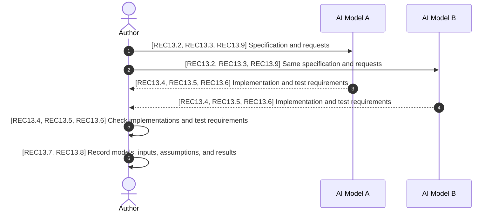

# Modern Spec Writing Guidelines

## Scope

This document gives guidance to specification authors and editors.
The guidance includes specification content, structure, and tests of implementations.

## Goal

Ambiguity can cause differences between implementations and between test results.

This guidance has two goals for authors and editors.

* Write specifications that humans can understand.
* Provide enough information in those specifications for AI systems to create implementations and test requirements.

## Normative references

| Reference | Version | Rules used in this document |
| --- | --- | --- |
| [RFC 2119](https://www.rfc-editor.org/rfc/rfc2119.html) | March 1997 | Requirement, recommendation, and permission levels |
| [RFC 8174](https://www.rfc-editor.org/rfc/rfc8174.html) | May 2017 | Use of uppercase keywords for these levels |
| [ASD-STE100](https://www.asd-ste100.org/) | Issue 9, January 15, 2025 | English writing rules and vocabulary |
| [Mermaid sequence diagrams](https://mermaid.js.org/syntax/sequenceDiagram.html) | Mermaid 12.3.0 documentation | Sequence diagram syntax |
| [GitHub Flavored Markdown](https://github.github.com/gfm/) | 0.29-gfm, April 6, 2019 | Headings, tables, and fenced code blocks |

## Terms and definitions

**Specification.** A document that states rules for a system, protocol, format, or procedure.

**Provision.** A statement that gives a requirement, recommendation, or permission.

**Target actor.** A participant to which the specification assigns provisions.

**External actor.** A participant outside the scope of the specification's conformance rules.

**Wire message.** Data that a protocol sends between implementations.

**Variable.** A named value that can change.

## Abbreviations

| Abbreviation | Meaning |
| --- | --- |
| AI | Artificial intelligence |
| ID | Identifier |
| JSON | JavaScript Object Notation |
| RFC | Request for Comments |
| STE | Simplified Technical English |

## Actors

**Author.** A person who writes or edits a specification. The Author is the target actor in this guideline.

**AI Model.** An external actor that can make an implementation or write test requirements from a specification.

## Interoperability test sequence

This informative diagram shows the test procedure in `REC13.1`.
Model A and Model B are example labels.
The order of the replies is illustrative.
Assumption. Each model sends both requested outputs to the Author.
The replies are inputs to the checks in Step 5.
The Author examines differences in Step 6 if the results differ.

## Provisions

The uppercase keywords MUST, MUST NOT, SHOULD, SHOULD NOT, and MAY have the meanings in RFC 2119 and RFC 8174.
Each provision applies when its condition is true.
A condition in a section applies to the provisions in that section.

### 1. Clear Scope

**REC1.1** The Author SHOULD give the scope of the specification at the beginning.

### 2. Normative References

**REC2.1** The Author SHOULD give a list of the external specifications necessary to interpret the specification.

**REC2.2** The Author SHOULD give a version and a link for each normative reference.

**REC2.3** The Author SHOULD identify the applicable rules in each normative reference.

### 3. Terms and Definitions

**REC3.1** The Author SHOULD put the definitions after the normative references.

**REQ3.2** The Author MUST NOT put requirements or recommendations in definitions.

**REC3.3** When a term comes from a normative reference, the Author SHOULD identify that reference in the definitions.

**REC3.4** The Author SHOULD NOT give a new definition to an imported term.

### 4. Abbreviations

**REC4.1** If the specification uses abbreviations or symbols, the Author SHOULD put their meanings in a table before the provisions.

### 5. Actors

**REC5.1** The Author SHOULD put the definitions of the actors before their provisions.

**REC5.2** The Author SHOULD identify the target actors.

**REC5.3** If interactions involve external actors, the Author SHOULD identify them.

### 6. Goal

**REC6.1** The Author SHOULD give the problem and the intended result.

**REC6.2** For each security claim, the Author SHOULD give its assumptions and limits.

### 7. Interactions and Cross-References

These provisions apply to specifications that define interactions.

**REC7.1** The Author SHOULD show the interactions in a Mermaid sequence diagram.

**REC7.2** The Author SHOULD use `autonumber` in each sequence diagram.

**REC7.3** The Author SHOULD NOT add manual step numbers to the diagram.

**REC7.4** The Author SHOULD NOT refer to a diagram note as a numbered step.

**REC7.5** For each message, the Author SHOULD give its provision IDs and key parameters.

**REC7.6** For each variable used in an interaction, the Author SHOULD identify its steps and provisions.

**REC7.7** For each provision that applies to an interaction, the Author SHOULD identify its steps.

**REC7.8** The Author SHOULD make the diagrams, tables, and provisions agree.

**REC7.9** The Author SHOULD identify optional paths and illustrative choices in the diagram or its description.

### 8. Active Voice and Actor Ownership

**REC8.1** The Author SHOULD make the actor the subject of each provision.

**REC8.2** For each interaction with an external actor, the Author SHOULD give the required behavior of the target actor.

**REC8.3** The Author SHOULD identify each assumption about the behavior of an external actor.

### 9. Labeled, Atomic Provisions

**REC9.1** The Author SHOULD put each provision in a separate paragraph or numbered item.

**REC9.2** The Author SHOULD give each provision a unique ID.

**REC9.3** The Author SHOULD identify the actor, condition, action, and expected result of each provision.

**REC9.4** For each specified failure action, the Author SHOULD write a separate provision.

**REC9.5** For each failure action, the Author SHOULD identify the provision for the input rule or failed check.

**REC9.6** For a received message, the Author SHOULD give separate conditions for receipt and acceptance as valid.

**REC9.7** The Author SHOULD use the prefix in the table for each provision ID.

| Prefix | Keywords |
| --- | --- |
| `REQ` | MUST or MUST NOT |
| `REC` | SHOULD or SHOULD NOT |
| `PERM` | MAY |

### 10. Simplified Technical English

**REQ10.1** The Author MUST use ASD-STE100 for the English text of the specification.

**REC10.2** The Author SHOULD use short sentences.

**REC10.3** The Author SHOULD put one instruction in each sentence.

**REC10.4** The Author SHOULD use the same term for the same concept.

### 11. Structured Variable Constraints

These provisions apply when the specification defines variables.

**REC11.1** The Author SHOULD put variable constraints in a Markdown table or JSON Schema.

**REC11.2** For each variable, the Author SHOULD give its type, presence, permitted values, and prohibited values.

**REC11.3** The Author SHOULD show which values the specification prohibits and which values it does not specify.

**REC11.4** For each list of values, the Author SHOULD show if extensions are possible.

**REC11.5** The Author SHOULD show where letter case changes the meaning of a value.

**REC11.6** For encoded values, the Author SHOULD show the data values separately from their encoded forms.

**REC11.7** If quotation marks show the limits of a value, the Author SHOULD identify those marks.

**REC11.8** If data contains quotation marks, the Author SHOULD identify them separately from the marks that enclose the value.

**REC11.9** For a variable constraint table, the Author SHOULD use the columns in the table below.

The list of provision ID prefixes is complete. The prefix is case-sensitive.

| Variable / Parameter | Context | Sequence Step & Provisions | Type | Presence | Allowed Values | Disallowed Values |
| --- | --- | --- | --- | --- | --- | --- |
| Provision ID prefix | Beginning of a provision ID | `REC9.7` | Text | Required | `REQ`, `REC`, or `PERM` as specified by the keyword | All other values |
| Specification version | Input to each AI Model | Steps 1 and 2, `REC13.2` | Document version | Required | Same version for all models | Different versions for different models |
| Number of AI Models | Models that get the specification | Steps 1 and 2, `REC13.2` | Integer | Required | Two or more different models | Fewer than two different models |

### 12. Wire Examples and Tests

**REC12.1** If an example contains wire messages, the Author SHOULD put them in fenced code blocks.

**REC12.2** If the specification defines a wire protocol, the Author SHOULD show typical flows and main errors in wire examples.

**REC12.3** The Author SHOULD identify illustrative examples as non-normative.

**REC12.4** For each example, the Author SHOULD identify its applicable steps and provisions.

**REQ12.5** The Author MUST NOT add requirements in examples.

**REC12.6** For wire examples, the Author SHOULD make sure that byte counts, escaping, and encoding are correct.

**REC12.7** For each wire example, the Author SHOULD identify placeholders and omitted data.

**REC12.8** For detailed cases, the Author SHOULD use test vectors or test requirements.

**REC12.9** The Author SHOULD include valid, invalid, and boundary cases in the tests.

**REC12.10** For each case, the Author SHOULD give the expected result and the provision that specifies it.

### 13. AI Interoperability Testing

These provisions apply to specifications for protocols that independent implementations can use to exchange messages.

**REC13.1 (Steps 1 to 6)** Before the specification becomes final, the Author SHOULD do the interoperability test in this section.

**REC13.2 (Steps 1 and 2)** The Author SHOULD give the same specification version to at least two different AI Models.

**REC13.3 (Steps 1 and 2)** The Author SHOULD tell each AI Model to make an independent implementation.

**REC13.4 (Steps 3 to 5)** The Author SHOULD do a test that shows if the implementations exchange messages correctly.

**REC13.5 (Steps 3 to 5)** The Author SHOULD compare each implementation with the provisions.

**REC13.6 (Steps 3 to 5)** The Author SHOULD compare the generated test requirements with the provisions.

**REC13.7 (Step 6)** The Author SHOULD record the models, inputs, assumptions, and results.

**REC13.8 (Step 6)** If the results differ, the Author SHOULD examine the differences for ambiguities in the specification.

**REC13.9 (Steps 1 and 2)** The Author SHOULD tell each AI Model to write test requirements.

## Examples (non-normative)

### Separate provisions for a check and a failure action

This example illustrates `REC9.4` and `REC9.5`.

**REC-EX1** Before review, the Author SHOULD make sure that each provision ID is unique.

**REC-EX2** If the check in `REC-EX1` finds a duplicate, the Author SHOULD correct the duplicate ID.

### Test requirements

Each row gives a sample provision ID and keyword.

| Input | Keyword | Case | Expected result | Provision |
| --- | --- | --- | --- | --- |
| `REQ10.1` | MUST | Valid | The prefix is correct for MUST. | `REC9.7` |
| `REC1.1` | SHOULD | Valid | The prefix is correct for SHOULD. | `REC9.7` |
| `rec1.1` | SHOULD | Invalid case | The prefix is incorrect because it has lowercase letters. | `REC9.7`, `REC11.5` |
| `1.1` | SHOULD | Boundary with no prefix | The ID has no prefix and fails the check. | `REC9.7` |

The [OAuth Form Post example](examples/oauth_2_0_form_post_response_mode_1_0_modern_spec.md) shows an application to a wire protocol.
